# USE-0004 — Editing a Structured Image While Preserving Representation Consistency

**Status:** DRAFT  
**Disposition:** CANDIDATE  
**Created:** 2026-10-27  
**Updated:** 2026-10-28  
**Type:** Informative use case

> `USE-0004` is an informative IMXO use-case description, not a normative specification, a mandatory editor algorithm, a completed object model, or proof that a custom container is needed. The v0.1 format is static and passive: it contains no JavaScript, macros, events, executable scenarios, animation logic, or automatic network requests. Normative decisions are made separately in `REQ`, `DES`, `ADR`, and `SPEC` after research.
>
> **Editorial note:** Sections 1–20 and Figures 4.1–4.3 and 4.5–4.6 are presented as a reconstructed coherent edition because a separate verbatim approved source for those blocks was not found in the working tree or repository history at publication time. This text is not represented as a verbatim original and remains subject to author review. This does not change the informative status of the scenario. Sections 21–47 consolidate the agreed outcomes of later passes with consistent terminology throughout.

## Contents

- **Block 1, §§1–10.** Actors, problem, conditions of use, applicability, and completeness.
- **Block 2, §§11–20.** Editing operations, text, export, and working-state history.
- **Block 3, §§21–30.** Identity, relationships, provenance, applicability, and cascading effects.
- **Block 4, §§31–40.** Completion, errors, security, verification, compatibility, and privacy.
- **Block 5, §§41–47.** Alternatives, comparison, hypotheses, research, and conclusions.

## 1. Actors and systems

The primary actor is a person or program modifying an existing structured image or creating a derived state of it. The scenario may involve a graphics editor, a tool for editing OCR and semantic annotations, a viewer with modification capabilities, a computer-vision system, an automated processing tool, an exporter, a validator, and an end consumer.

The file creator, the authors of individual annotations, the party performing the edit, and the consumer of the result need not be the same. An image may contain assertions from several sources. An editor may support only some of that data and may lack access to the source application, earlier states, or external provenance evidence.

The goal of the scenario is not to require every application to perform the same operations. What matters is analyzing which properties of the result can reasonably be preserved or confirmed within a particular task.

## 2. Context

IMXO is considered as a possible portable representation of visual content together with text, regions, masks, annotations, relationships, and additional information. During later editing, these representations may change in different ways.

Ordinary raster editing may break the correspondence between earlier annotations and the resulting image. Changing vector content may alter visibility, stacking order, and spatial relationships. Correcting OCR or an alternative description, by contrast, may leave the pixels entirely unchanged. Export to a less expressive format may intentionally omit most of the structure.

The source file is not assumed to be error-free, fully structured, or produced by a trusted tool. Missing provenance information, unavailable previous states, and unknown extensions are realistic initial conditions.

## 3. Problem and need

When one image representation changes, other representations may remain technically intact while beginning to describe the wrong state. Relationships cannot all be treated alike: intersecting regions do not necessarily imply semantic dependency, and common provenance is not enough to recalculate assertions automatically.

The project needs to investigate which properties can survive editing, when additional processing is needed, how to distinguish an established inconsistency from missing information, and how to pass material limitations to the next program. The problem cannot be solved by unconditionally deleting all unknown structure or by requiring universal recognition and proof of truth.

## 4. Goal

Consider ordinary editing of a structured image while accounting for available relationships among graphics, text, regions, and assertions, without treating technical data preservation as a claim that the data remain semantically applicable.

The scenario separately considers the user-visible result, retained structure, the quality of geometric transformations, known limitations, partial support, and usability by other implementations. These are use-case expectations to be researched, not completed IMXO requirements.

## 5. Trigger

The scenario begins when a user or external system opens an image for modification, corrects incorrectly recognized text, edits annotations, moves or copies depicted content, crops a composition, changes vector properties, or prepares an export. The operation may be manual, batch-oriented, or performed through another application.

The trigger does not require modification of the source file: the result may be a separate copy, a derived IMXO file, or an exported representation.

## 6. Main scenario

1. The editor receives a file and determines the part of its visual and structured content that it understands.
2. The intent of the operation and material conditions for the result are established, such as the need to preserve particular annotations.
3. Graphics, structure, text, relationships, rendering properties, or a combination of them are modified.
4. The effects of the change on available dependencies are considered; unknown dependencies are not automatically declared absent.
5. Supported information is processed. For the rest, the available outcomes may include preservation with a limitation, exclusion from a particular result, or refusal, depending on the task.
6. A new working state is formed and, when needed, a particular file or separate export is saved.
7. Individual properties may be verified within a defined scope. The recipient uses the information actually delivered according to its reading capabilities.

This is a logical scenario sequence, not a mandatory editor architecture. A real implementation may perform checks earlier, later, and repeatedly.

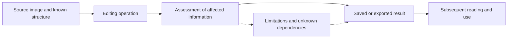

*Figure 4.1 — Main scenario for editing a structured image. The diagram is illustrative and does not define a mandatory processing pipeline.*

## 7. In scope

The scenario includes ordinary modification of raster and vector content; editing of text and annotations; moving, copying, partial cutting, splitting, joining, scaling, rotating, cropping, overlapping, and redistributing visibility; saving; and exporting. It considers identity, geometry, semantic assertions, provenance, multiple annotators, dependencies, partial support, uncertainty, verification, and error risks.

It does not assume that every editor can perform every operation or guarantee the semantic truth of assertions. Both interactive and automated transformations are considered.

## 8. Out of scope

The scenario excludes the design of a particular binary container, field layout, universal truth-verification algorithm, mandatory edit history, cryptographic infrastructure, unified editor protocol, external agent-management system, or network link-resolution mechanisms.

**Sanitization** is the separate `USE-0002`: ordinary hiding or cropping does not promise removal of selected information from all retained representations related to it. Whether hidden application values may be captured initially is constrained by `USE-0001`. AI use of information and actions performed by agents are covered in `USE-0003`.

The scenario concerns a static image and introduces no temporal video model.

## 9. Inputs and conditions

The input may be an IMXO file with known or partially unknown structure, an imported annotated image, a file with several sets of assertions, or a derived image. Some information may have been produced by OCR or CV tools, people, the source application, or an unknown source.

The initial state may contain incorrect annotations, misaligned regions, unknown extensions, signatures and hashes with a defined scope, hidden graphic layers, alternative representations, and historical information. These are not assumed to be mandatory elements of every file.

An operation may have material conditions: preserve editability, retain particular annotations, produce a visual-only representation, or leave the source untouched. The result is evaluated against those conditions.

## 10. Applicability, completeness, verification, and operational profile

### 10.1. Independent characteristics

**Presence:** whether a particular record occurs in the file or representation being considered. **Applicability:** whether an assertion relates to the relevant image state and property. **Credibility:** whether there are grounds to consider it true. **Structural consistency:** whether known relationships and references are correct. **Verification:** which properties and states were actually checked. These characteristics are not mandatory IMXO fields and may have different outcomes.

Applicability may be established, disproved, or unknown. Lack of verification does not mean error; retention of a record does not prove its applicability.

### 10.2. Completeness relative to a defined scope

The following are distinct: completeness of source information for the task, completeness of the part of the file that was read, completeness of processing of affected relationships, completeness of the resulting representation, and completeness of verification. Complete processing of everything known to the editor does not prove complete processing of unknown extensions.

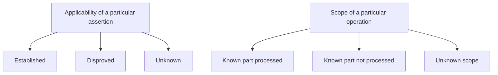

*Figure 4.2 — Independent axes of assertion applicability and processing coverage. These are analytical distinctions, not normative enumerations of states.*

### 10.3. Transformation contexts

The scenario distinguishes the **source context** (received data and prior knowledge), **working context** (editing state), **saved context** (the particular data written), and **recipient context** (what a later program actually received and understood).

The editor's knowledge is not necessarily written into the file. The recipient does not necessarily read all written structure. This is not a requirement to store four states inside IMXO.

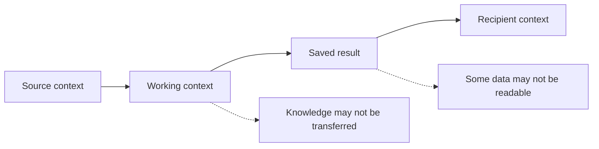

*Figure 4.3 — Four contexts for evaluating a result. The diagram describes observable boundaries, not a mandatory history of states.*

### 10.4. Operational profile

Operations may be interactive or batch-oriented, one-off or repeated. Typical sizes, number of regions, number of annotators, peak load, and editing frequency are **not established and require research**. Whether manual review is realistic depends on the volume and purpose of the data. Resource cost matters, but normative thresholds have not been defined.

The expected useful lifetime of a result ranges from a short-lived working file to a long-retained image. Specific retention periods, the provenance-verification horizon, and the acceptability of external dependencies are **not defined for the general scenario**. Offline reading may matter, but a need for fully self-contained proof of every assertion is not assumed.

## 11. Common editing operations

Operations differ in what changes: image data, spatial association, annotation structure, assertion values, composition, or only rendering conditions. The same geometric action applied to a whole object and to a fragment may have different semantic effects.

### 11.1. Moving an entire element

A known transformation may allow recalculation of bounding-box and mask coordinates associated with an independent element. Earlier assertions about its relationship to its surroundings may nevertheless become inapplicable. Not every recognized object exists as an independently editable graphic element; it may be only part of a single raster.

### 11.2. Copying and partial selection

Copying creates a new graphical instance, not a new independent observation of the real world. A partial selection and move may leave a geometrically valid fragment to which the category of the former whole does not apply. Uncertainty must not be hidden by automatically inheriting every annotation.

### 11.3. Example: moving part of a car

When the front part of a depicted car is cut out and moved, the new fragment does not necessarily become a separate entity in the category “car.” The source region may lose its previous meaning. A known relationship between the fragment and the original image does not prove that a separate new car exists.

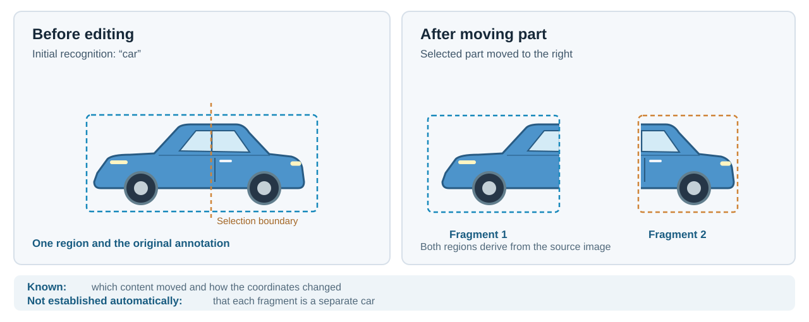

*Figure 4.4 — Moving part of a car: a correct geometric transformation does not confirm that the original classification remains applicable to every fragment. The source SVG is used for publication; no PNG is added.*

### 11.4. Splitting and joining

Splitting an image into several regions does not necessarily mean that several depicted objects have been created. Joining fragments from different sources does not prove that a single real-world referent has appeared. In both cases, the source assertions, their scope, and available transformation information matter.

## 12. Scaling, rotation, and coordinates

Geometric transformations may apply differently to rectangles, polygons, points, and masks. Coordinate transformation may be mathematically determined, but correctness also depends on the coordinate system, rounding, boundaries, and region shape.

A mask that fit the source raster may not remain correct after nonlinear deformation. Rotation may change a bounding box without changing a semantic category. Scaling may affect the recognizability of small text. This section defines no normative coordinate system or interpolation method; those subjects require later research.

## 13. Changing the image and changing semantic information

A graphic transformation must be distinguished from changing a separate assertion. If a user corrects an object category without changing the image, that is a complete structured edit. If a user replaces depicted text, that is a graphic change that may affect OCR and textual descriptions.

### 13.1. Editing an annotation

A user may correct an incorrect object name or add a new description. A correction to an earlier value must be distinguished from a new independent assertion. An external program is not required to consider a new record true merely because it appears in the file.

### 13.2. Editing pixels

Local recoloring, retouching, or painting over a fragment may affect classification, OCR, masks, geometry, and spatial relationships. It cannot be concluded that there was no effect merely because an annotation rectangle remained unchanged.

### 13.3. New assertions after analysis

After editing, a user may run OCR, CV, or AI analysis and add new annotations. Such a result has its own provenance and need not replace every alternative assertion. No built-in obligation to launch this analysis automatically is assumed.

### 13.4. Illustration of alternatives

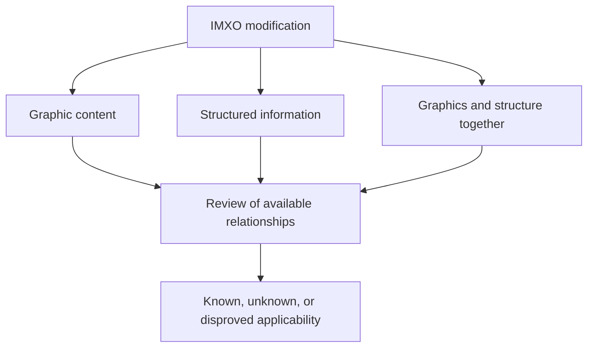

*Figure 4.5 — Different kinds of editing operations and their possible effects on information.*

## 14. Cropping, occlusion, and visibility

Cropping may change only the visible area or may physically exclude graphic data, depending on the operation and editor. Covering content with an opaque object may hide previous pixels without destroying them. These cases are not equivalent to secure content removal.

An annotation describing a fully visible car may become inapplicable after an occlusion is added even though the bytes representing the car remain unchanged. Residual annotations for the hidden region may remain in the file; whether this is acceptable depends on the purpose of the operation and conditions of transfer.

## 15. Erasure and deletion during ordinary editing

Deleting a graphic element, deleting an annotation, and deleting related data may have different effects. Removing one record does not necessarily exclude the corresponding information from the raster and other representations. Conversely, automatically deleting every geometrically intersecting annotation may destroy independent useful information.

If the user specifically requests sanitization, the separate expectations of `USE-0002` apply to selected content and known derived or residual structures. Ordinary editing by itself provides no such guarantee.

## 16. Vector content, text, and fonts

Editing a vector element may preserve it as an independent element or may cause rasterization. Text may exist as editable character content, vector outlines, raster content, or a separate OCR assertion. These representations are not interchangeable for every task.

The following are distinct: correcting recognition output, adding a user description, changing a semantic category, and changing directly visible lettering. For example, changing OCR output from `B` to `8` does not change the pixels, while changing graphical text may require OCR review.

Different fonts, missing-glyph fallback, styling, color, wrapping, and multilingual text must be considered. No embedded font or reference rendering mechanism is prescribed. A permissible accessibility description that is not visible in the raster must not automatically be treated as an error.

## 17. Saving, export, and interchange

Saving a modified IMXO file and exporting to another format are different operations. Export to a simple raster may remove almost all structure; that may be acceptable for one task and unacceptable for another. When exporting to PDF, SVG, or another structured format, some annotations may transfer while others may change meaning or be lost.

### 17.1. Expressiveness of the target format

Physical retention of text does not necessarily preserve the correct region, provenance, or applicability limitation. Selecting a representation requires evaluating not only bytes but also the context available to the recipient.

### 17.2. Partial support

Unsupported data may be preserved opaquely, excluded from a particular export, or cause refusal to produce a result with the required properties. No universal strategy is established here.

### 17.3. Editability after export

Graphics may look identical before and after export while no longer being editable as independent elements. Preserving appearance does not prove preservation of structure.

### 17.4. Illustration of export boundaries

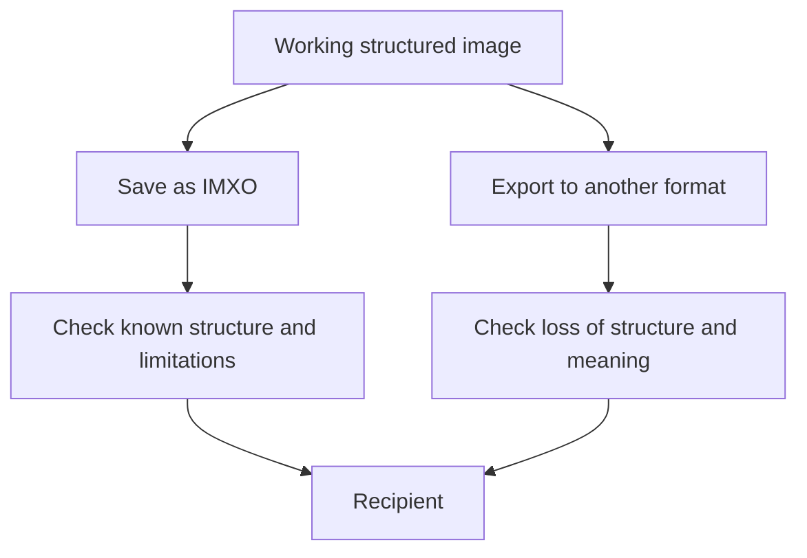

*Figure 4.6 — Saving IMXO and exporting may have different completeness and verification boundaries.*

## 18. Undo, redo, and previous states

An editor may provide internal undo and redo without storing history inside IMXO. Reverting a working action, restoring an earlier file, and retaining stored history are different mechanisms. The availability of undo does not imply that a recipient can recover earlier values.

Preserving provenance does not automatically require retention of earlier pixels, text, sensitive values, or complete object versions. Previous context may be known, partly known, or unavailable.

## 19. Multiple annotators and sources

Different parties may describe the same depicted content with different words, masks, and regions. Their assertions may be alternatives, compatible, or conflicting under known conditions. Every difference in classification must not automatically be called a conflict.

Several processes that use the same incorrect source result do not automatically create independent confirmations. Confidence values from different analyzers may use incomparable scales. Provenance provides useful context but does not itself prove an assertion true.

## 20. Possible outcomes and processing boundaries

When a structured image is modified, possible outcomes include transformation of known data, preservation of particular records, preservation with a known limitation, exclusion from the result, changing the operation's conditions, or refusing to produce a result with the requested properties.

**A possible outcome is not automatically successful for every task.** If all annotations had to be preserved, silently excluding them may violate a material condition of the operation. If only a visual export was requested, absence of structure may be expected.

Successful execution of one transformation, completeness of processing known data, actual persistence, and fitness for the next consumer must be distinguished. Inability to assess a semantic property does not prove that property incorrect. A result with known uncertainty must not be presented without grounds as fully verified.

## 21. Identity of the described content

Identity after a change may refer to continuity of a graphical element, identity of a depicted entity, an assumed real-world referent, or a particular assertion. These are analytically different questions. A copy of a drawn car is a new graphical instance, but not necessarily a depiction of a different physical vehicle. A repeated “car” annotation may derive from an earlier record rather than constitute an independent observation.

### 21.1. Graphical representation

An editor that knows the source element and transformation may sometimes trace its continuity. A part of a whole raster recognized as a car is not necessarily a standalone graphical element. Cutting an object in half or combining different sources makes identity claims harder.

### 21.2. Depicted entity and referent

Several regions may describe one scene or different entities; an artistic, synthetic, or schematic image may have no established physical referent. Matching class, color, or shape does not prove identity of a real object.

### 21.3. Continuity of an assertion

Knowing that an annotation was copied from another record establishes continuity of the record, not the truth of its original text. Correct copying preserves an incorrect source annotation. Without information about the previous state, identity and source context may remain unknown.

### 21.4. Boundary for a future model

This USE does not establish mandatory global identifiers, rules for changing them upon copying, or a complete-history mechanism. **Identity cannot be derived universally from geometry, common provenance, or matching categories.**

## 22. Objects, regions, and multiple representations

Graphical data, spatial regions, and assertions about content do not always form one-to-one relationships. One region may have several descriptions; one assertion may apply to several regions; one vector element may have no semantic annotation. Different sources may identify the same entity with different boxes and masks.

### 22.1. Graphics and annotations

A car may be part of a larger raster and not exist as a separately editable element. A wheel annotation may overlap a road annotation, but the overlap alone does not prove a part–whole relationship. Geometric containment is not a universal semantic relationship either.

### 22.2. Visible and stored content

An editable file may contain a graphical element hidden by a mask or another layer. This differs from invisible internal state of the source application that was not part of the permissible user representation when a screenshot was made. The ability to edit hidden content inside a file does not authorize capturing hidden application values.

### 22.3. Multiple links

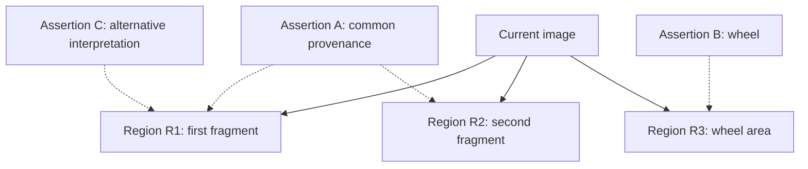

*Figure 4.7 — Several regions and assertions. The notation is illustrative, and the absence of a line between regions does not prove the absence of every relationship.*

### 22.4. Conclusion

Research must distinguish graphical elements, regions, and assertions **without presupposing a mandatory list of IMXO object classes**.

## 23. Relationships, provenance, and applicability dependencies

A **relationship** describes a particular connection; **provenance** describes a source or transformation; an **applicability dependency** describes a possible effect of a change on a particular property. They may coincide in specific cases but are not identical.

| Relationship | Example | What it does not prove |
|---|---|---|
| Spatial | A car is left of a building | Independence from future movement |
| Part–whole | A wheel belongs to a car | That the relationship can be inferred from overlapping boxes |
| Structural | A reference or group membership | Truth of a semantic category |
| Derived | An annotation was produced from OCR | That both records must change identically |
| Provenance | Data came from a source | Credibility or independence of that source |

A dependency should be analyzed relative to a **particular property and transformation**. A color change may affect the assertion “red” but not necessarily the category “car.” A move may affect “left of the building” without changing license-plate characters.

Applicability can also depend on composition. If the car itself is unchanged but an opaque shape is placed over it, “fully visible” may become false. A known link, an unknown relationship, and no established effect are different knowledge states. Absence of an explicit relationship is not evidence that no dependency exists.

## 24. Changes to relationships after operations

Moving an object can change its relationship to its surroundings while its internal classification remains applicable. When copying, the source instance's relationships to its surroundings need not transfer to the copy. After splitting, common provenance of the parts does not prove that several semantic objects exist.

Combining fragments may produce a new visual result without a single real-world referent. A group move may preserve some relative positions and change others, especially when combined with rotation or scaling. Applying a mask may change visibility without changing source pixels.

The source annotation may already have been wrong; a result must not be declared incorrect solely because it differs from an old record without examining that record's context. If earlier relationships were not stored, reconstructing them from the current image may be impossible.

**Conclusion:** consequences depend on the available information about the operation and on particular relationships and properties, not on a universal rule to “move all related data.”

## 25. Context, applicability, and compound annotations

**Source context** is the state relative to which an assertion was created; **current context** is the state considered after the change; **use context** comprises a consumer's information and purpose. These contexts may be incomplete and need not be stored fully in the file.

### 25.1. Three different statements about the past

Distinguish (a) knowing which context a record referred to, (b) knowing what it asserted at that time, and (c) confirming that it was correct. The first two do not prove the third. A “car” record may have existed before editing and been wrong from the outset.

### 25.2. Retaining and using a record

A retained historical record does not automatically become a confirmed current annotation of the edited image. Correct interpretation depends on whether the file can convey the relevant limitation and whether the recipient understands it. If an export drops the limitation, preserving the old value can misrepresent the result.

### 25.3. Separate properties of an annotation

| Property | Possible consequences |
|---|---|
| Geometry | May be transformed mathematically |
| Category | May remain applicable, lose applicability, or become unknown |
| Analyzer confidence | May remain information about the original computation, but not an assessment of the new state |
| Spatial relationships | May change when content moves |
| Provenance | May remain as a historical fact or source assertion |
| Visibility | May change through occlusion |

This table is not a normative requirement to store every property as a separate object.

### 25.4. Boundary with sanitization

Ordinary editing may retain a record with historical context. In sanitization, selected content to be removed must not remain in the final file merely because it is labeled historical. Detailed conditions belong to `USE-0002`.

## 26. Annotations from different sources, alternatives, and conflicts

Different records, authors, processes, and demonstrated independence of evidence must be distinguished. Two analyzers may use the same source OCR, a shared model, or the same faulty data. Recalculation and copying do not necessarily produce independent evidence.

“Vehicle,” “car,” and “truck” may be compatible classifications. “Car” and “bicycle” within one large region are not necessarily contradictory either: they may refer to different objects. A genuine conflict requires comparison of subject, property, region, context, time, and classification system. If these cannot be established, conflict may remain unknown.

Confidence scores from different models need not be directly comparable: `0.92` from one algorithm is not universally stronger evidence than `0.75` from another.

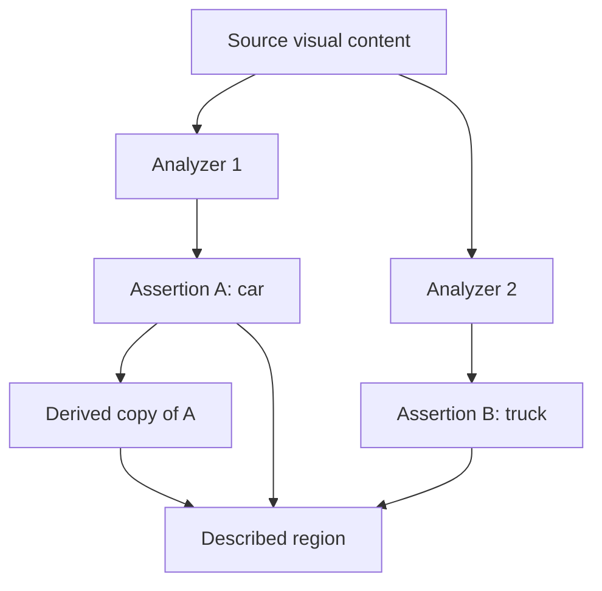

*Figure 4.8 — Separate assertions and a derived record. The diagram neither confirms independence of the analyzers nor declares their classifications contradictory.*

## 27. Dependencies and cascading consequences

Cascading **impact** means that a change may affect other information; cascading **deletion** is only one possible processing outcome. Earlier OCR of a license plate may lose applicability after its characters change; geometry for the same region may need recalculation after movement. A general “car” annotation may remain usable, although that does not make its verification automatic.

### 27.1. Known and possible impact

A verifiable dependency differs from suspected possible impact and from no established impact. The last state is not proof of absolute independence.

### 27.2. Composition effects

The direct source of an annotation may remain unchanged while the rendered result changes because of a mask, layer order, or opacity. This matters for assertions about visibility, position, and compositional properties.

### 27.3. Cycles

A cycle of structural references A→B→A does not automatically imply a cyclic applicability dependency. Provenance chains are another relationship type that must not be conflated with either. This USE selects no universal cycle-resolution mechanism.

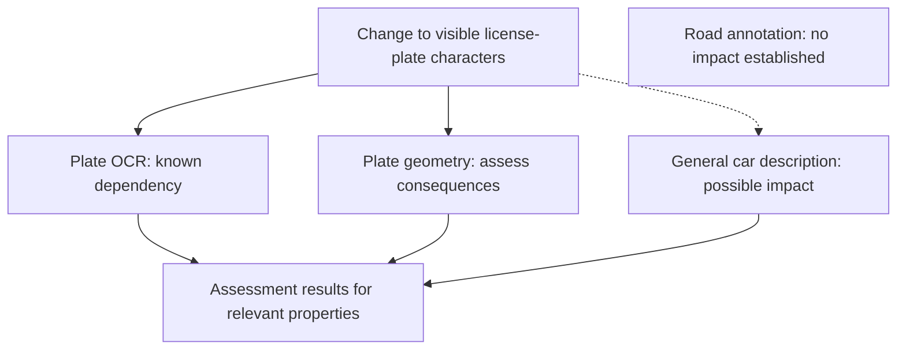

*Figure 4.9 — Known dependencies, possible impact, and information with no established impact. The road annotation is not declared demonstrably independent.*

### 27.4. Structure and meaning

A reference may resolve to an existing identifier yet designate the wrong object after a transformation. Physical correctness, structural connectivity, correctness of semantic targeting, and truth of a classification must therefore be assessed separately.

## 28. Provenance, integrity, trust, and privacy

A provenance record is an assertion and may be false or incomplete. A known source does not confirm the truth of its result. The existence of a record, integrity of its content, and credibility of the event it describes must be distinguished.

Integrity checks have scope. A hash of one block may still match after other content changes, but that does not confirm preservation of a semantic relationship. The bytes of a “car” annotation may match their hash while its reference points to a different region. A signature over one state does not necessarily confirm later transformations.

Provenance may include sensitive information: source paths, user identifiers, previous values, or hashes of removed data. Such information should not be collected automatically merely to make history complete. During sanitization, provenance metadata receives no exemption if it retains selected content that must be removed.

**Conclusion:** value integrity, linkage, applicability, truth, trust, and privacy are independent properties. This USE does not propose a single numerical “trust score” for the whole file.

## 29. Partial support and loss of context

An editor may fully understand one structure, see another block without understanding its semantics, or be unaware of particular dependencies. Byte-for-byte preservation of an opaque block does not prove applicability of its data to the edited image. Unconditional deletion may also break relationships and destroy useful information.

### 29.1. Semantic loss without data loss

Editor A may establish that a classification is unconfirmed after cropping but export the category without that limitation. Editor B then receives “car” as an ordinary annotation. The data survived, but the meaning of the original assertion changed for the recipient. This is broader than merely failing to recognize an unknown block.

### 29.2. Different levels of correctness

Syntactic readability, structural consistency, correctness of semantic targeting, applicability, and completeness of conveyed limitations must be distinguished. No one level proves the others.

### 29.3. Limits of the claimed result

Depending on material conditions, limited preservation, transformation, exclusion, or inability to complete an operation with the requested properties may be appropriate. If a limitation cannot be represented to the recipient, silently preserving an old annotation may be unacceptable. This USE does not mandate error codes or a particular mechanism.

## 30. Semantic test cases

This section exercises identity, relationships, context, alternative annotations, and semantic consequences. Technical write failures, implementation compatibility, and parsing security are addressed in §40. These are research cases, not normative conformance tests.

| No. | Case | Distinction under study |
|---|---|---|
| 1 | Move a whole car | Geometry and classification |
| 2 | Copy a car | Graphical instance and referent |
| 3 | Move part of a car | Fragment and semantic entity |
| 4 | Combine images from different sources | Composition and provenance |
| 5 | Overlapping annotations | Geometry and semantic relationships |
| 6 | Change license-plate characters | OCR, geometry, and content |
| 7 | Change an object category | Record and credibility |
| 8 | Two different analyzers | Sources and independence of evidence |
| 9 | Copies of one annotation | Derivation and observation |
| 10 | Compound annotation after movement | Applicability of individual properties |
| 11 | One assertion about several regions | Multiple representations |
| 12 | Cyclic structural relationships | References and applicability dependencies |
| 13 | False provenance | Presence of a record and credibility |
| 14 | Occlude an unchanged object | Content and visibility |
| 15 | Earlier classification no longer applicable | Record retention and current applicability |
| 16 | Synthetic image | Depicted entity and referent |
| 17 | Unknown previous context | History and verifiability |
| 18 | Initially wrong annotation transformed correctly | Operation and original truth |

**Compound example.** A source car image is copied; one copy is rotated and partly cropped, a classification from another analyzer is added, and the result is combined with another image. Graphical instances, provenance of parts, known relationships, and applicability of each annotation must be assessed separately. Neither complete history in the file nor an externally unsupported “correct meaning” may be assumed.

Future tests may be structural, use examples with known expected results, or be exploratory and require external expert assessment. These categories do not establish IMXO conformance levels.

## 31. Expected editing result

The result may be a change to graphics, corrected OCR, a changed annotation or relationship, a new file, or a separate export. Absence of visual change does not mean that no editing operation occurred. Conversely, the desired visual result does not automatically confirm correctness of all structured information.

| Characteristic | Question |
|---|---|
| Operation fulfillment | Was the requested change performed? |
| Content | Which images and structured information entered the result? |
| Structural consistency | Are known relationships and references correct? |
| Geometry | Does a known region correspond to the changed representation? |
| Semantics | Is a particular assertion applicable to this state? |
| Completeness | Which data and dependencies were covered? |
| Verification | Which properties were actually confirmed? |
| Fitness | Is the result suitable for the stated task? |

For example, exporting one raster without annotations may be correct for publication but wrong for continued structured editing. Universal success cannot be claimed without considering the operation's material conditions.

The same stored content may render differently across applications because of fonts, color handling, and graphical effects. Assessment of the visual result also has a defined scope.

## 32. Completion conditions and success boundaries

**Performing the transformation**, **meeting known material conditions**, **preserving data**, and **fitness for subsequent use** are different characteristics. An editor might correctly move a graphical part and save a technically readable file while losing annotations that the user required it to retain.

Analysis may distinguish completion within stated bounds, a result with known limitations, failure to meet material conditions, an incomplete operation, and an indeterminate state after failure. These are not normative IMXO statuses. “Completed with limitations” is not automatically successful when those limitations conflict with the user's purpose.

Verifying only some properties may suffice for a narrow task. In another task, lack of verification of a material property makes the result unsuitable. “Successful” therefore applies to an explicitly stated scope, not every possible property of a file.

## 33. Errors and representation inconsistencies

Editing can produce a graphical error (the wrong region was changed), a geometric mismatch (a mask remained at its old location), an incorrect structural reference, an incorrect classification, lost provenance, a limitation lost during export, or a partially written file. These must not all be reduced to one condition called “IMXO corruption.”

### 33.1. Pre-existing errors

The source file may already contain incorrect OCR or an obsolete annotation. Discovering a problem after editing does not prove that the current editor introduced it. If earlier context is unknown, the source of the error may also remain unknown.

### 33.2. Intentional semantic change

A user may replace “car” with “bicycle” without changing the image. Software may technically preserve the requested record correctly. This does not prove that the classification is true, but neither does it necessarily indicate a serializer defect. Technical execution of the user's action and truth of the resulting assertion must be distinguished.

### 33.3. Unknown applicability

If an editor does not know whether a cropped depiction still represents a car, uncertainty is neither a confirmed error nor confirmation of correctness. The opposite mistake is also possible: deleting independent data because a cascading rule is too coarse.

### 33.4. Different renderings

Different renderers may produce different text or composition geometry without obvious file corruption. Spatial annotations may be affected. Acceptable limits for such differences remain a research subject.

## 34. Incomplete processing and inability to provide required properties

An editor may support known geometric regions while not understanding specialized masks or extension semantics. It may then know that a dependency is affected without having a way to process it. An opaque block may be independent of the operation or may contain information that becomes obsolete.

Unlike §29, which addresses the meaning of partial support, this section concerns limits on **performing a particular operation**. Preservation, modification, exclusion, or inability to complete the operation are assessed against §32. Removing an unknown block may affect other references, so unconditional exclusion is not universally safe.

Partial support for a valid file must be distinguished from continuing after an invalid parse of an untrusted structure. Availability of the raster does not guarantee that interpreting the rest of the state is safe. Known incompleteness does not prove all other information wrong, but it limits what may be claimed about the result.

## 35. Saving the result and technical failures

The working representation, the file actually written, and the instance received by the next consumer may differ. Checking a structure before writing does not automatically confirm the bytes left on disk after a failure. Checking one saved state does not prove that it remains unchanged after later modification or transfer.

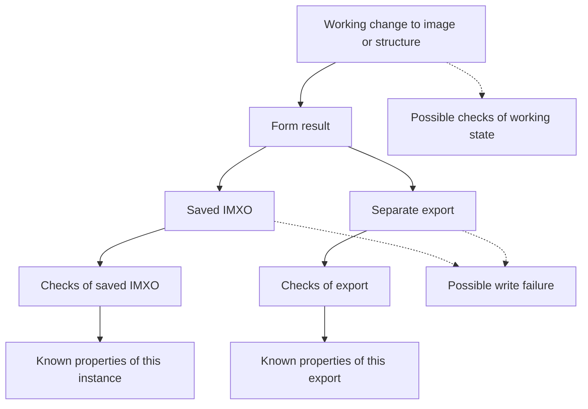

*Figure 4.10 — A working change, different results, and separate verification scopes. The diagram mandates no pipeline, atomicity, or logging mechanism.*

### 35.1. Write failure and durability

If a write is interrupted, some blocks may be missing or damaged. Completion of a write operation also does not always guarantee durability through a later system failure. This USE does not specify atomic replacement, synchronization, recovery, or journaling mechanisms.

### 35.2. Reopening

Software may successfully read its own faulty export if writer and reader share the same incorrect assumption. An independent implementation may find a different result, but independence alone does not prove it correct. Verifiable rules and data matter.

### 35.3. Concurrent changes

Two editors may modify different but interrelated regions or annotations rather than the same bytes. Their results may conflict. Mandatory locking, transactions, and merge rules are outside this USE.

## 36. Result verification and its limits

Integrity, provenance, trust, and applicability are defined in §28. This section addresses **what is checked**, using which data and within which scope: physical structure, syntax, known references, geometric transformation, an individual semantic hypothesis, transfer of a limitation, or a saved instance.

| Check | What it may confirm | What it does not prove |
|---|---|---|
| File reading | Known content was parsed | Truth of all annotations |
| Structural references | Known references resolve | Correctness of their semantic targets |
| Geometry | A known coordinate transformation was performed | Original correctness of the annotation |
| Semantic assessment | A particular assertion was assessed in this context | Truth of other assertions |
| Block integrity | Particular bytes are unchanged | Applicability of other related records |
| Transfer of limitations | A known limitation was retained | Absence of unknown limitations |

A completed check with no detected violation, a detected violation, a check not performed, and an inconclusive attempt are different. They are not normative file-state enumerations.

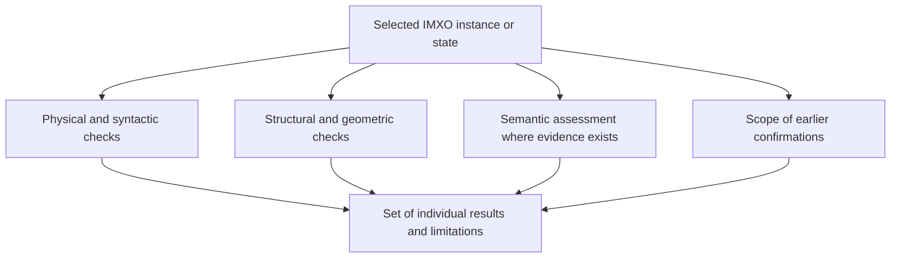

*Figure 4.11 — Independent checks of a particular state. The result is not a universal numerical trust indicator.*

### 36.1. Earlier confirmations

A stored `verified` mark, human review result, hash, or digital signature applies to some state and scope of data. A change may make that relationship inapplicable, but verification of an independent unchanged block need not become invalid. A signature does not automatically prove truth of depicted content.

### 36.2. Scope

External analysis may establish information not stored in the file. A later modification may make an earlier verification inapplicable. Re-analyzing the whole raster or applying AI is not a mandatory prerequisite for checking known structures.

## 37. Untrusted files and abuse

IMXO v0.1 is passive and includes no format-defined executable scripts. This does not guarantee that parsers and editors have no vulnerabilities. An untrusted file may use crafted dimensions, structure, nesting, identifiers, masks, and relationships to cause excessive resource use or processing errors.

### 37.1. Partial parsing

If unknown content cannot be parsed safely, availability of some data does not prove that the entire state is safe. Limited support for a valid extension differs from continuing after corrupted boundaries or unchecked references. Specific library behavior remains open.

### 37.2. False information and verification marks

An attacker may replace annotations, OCR, source information, or a verification mark without changing pixels. A technically valid file is not automatically credible. An earlier genuine mark may also be retained accidentally after its scope has changed.

### 37.3. Instructions in data

Structured text may ask an AI system to make a network request or ignore its rules. Such strings remain data, not IMXO commands. The authority and action policy of an external consumer are outside the format; `USE-0003` examines this boundary in detail.

## 38. Resources, rendering, and compatibility

Editing cost depends on more than the number of changed pixels: a small region may have many annotations and related assertions. Cyclic references do not necessarily form cyclic dependencies. Partial completion caused by time or memory limits does not prove all other data wrong, but it narrows the completeness that may be claimed.

### 38.1. Different rendered results

Identical stored data may render differently because of a missing font, different vector rasterization, color handling, transparency, masks, blending, or decoder capability. Text geometry may cease to match a different rendering. This USE adopts neither mandatory font embedding nor a single reference rendering.

### 38.2. Compatibility

The ability to open a file, preservation of an unknown block, correctness of structural references, semantic applicability of annotations, and fitness for a task must be distinguished. An older implementation may read the image without understanding newer semantic extensions. Over long-term storage, original fonts, sources, and applications may become unavailable; this is not the same as damage to the file itself.

## 39. Privacy and nonvisual semantics

Structured content need not match visible pixels completely. Alternative descriptions, accessible names, OCR, and semantic explanations may be legitimate and useful. Invisibility alone is not a leak. Technical access to an intentionally hidden application password does not, however, authorize including it in an ordinary screenshot.

After ordinary editing, a file may retain hidden layers, obsolete OCR, source regions, reduced copies, earlier values, and provenance data. This is not necessarily an ordinary-editing error, but it may create a material risk when the file is distributed. Even visible sensitive data becomes easier to extract and index at scale after OCR is added.

Three boundaries remain: **permissible initial capture** (`USE-0001`), **residual information after ordinary modification** (`USE-0004`), and **intentional exclusion of selected data from the final file** (`USE-0002`). Complete history must not be preserved automatically solely for provenance completeness.

## 40. Result, failure, and security test cases

Unlike §30, this section collects technical cases involving persistence, verification, exchange, and abuse. These are informative examples, not a normative test suite.

| No. | Case | Property under study |
|---|---|---|
| 1 | Only OCR changed; image unchanged | Structured editing |
| 2 | Working change made; writing not started | Working and saved state |
| 3 | Write interrupted | Indeterminate final file |
| 4 | File readable, but a known reference is broken | Readability and structural consistency |
| 5 | Working state checked, written state not checked | Verification scope |
| 6 | Verified instance changed before transfer | Verified and received state |
| 7 | Editor successfully reopens its own output | Limits of self-checking |
| 8 | Another application interprets the file differently | Compatibility |
| 9 | Font substituted and text layout changed | Rendering dependency |
| 10 | Opaque block copied unchanged | Byte and semantic preservation |
| 11 | Unsupported block excluded | Consequences of data loss |
| 12 | Export retained a category but lost its limitation | Context transfer |
| 13 | User required all annotations; some were excluded | Material operation conditions |
| 14 | Annotation contains an instruction for AI | Data and authority |
| 15 | Processing stopped at a resource limit | Completeness and uncertainty |
| 16 | Parser continued after corrupted boundaries | Partial-parsing safety |
| 17 | Secret values remained after occlusion | Editing and sanitization |
| 18 | Useful nonvisual description retained | Legitimate semantics |
| 19 | Invisible source-application password entered the file | Capture boundary |
| 20 | Two editors changed related structures | Concurrent editing |
| 21 | Verification of an earlier state remained | Scope of confirmation |
| 22 | Independent block still verifiable after another change | Local integrity |

**Compound example:** a user corrects OCR, moves part of an image, saves IMXO, and exports a raster. The IMXO write is interrupted; later, another application in a different rendering environment reads the partial result. The actual written instance, changes to structure and pixels, known links, conveyed limitations, rendering, and verified properties must all be established. Successfully displaying an image does not resolve every question.

Checks may be structural, use prepared examples, or require external expert evidence. Not every semantic conclusion can be checked automatically without additional information. Related open questions: `Q-0002`, `Q-0003`, `Q-0007`, `Q-0008`, `Q-0009`, `Q-0011`, `Q-0012`, `Q-0014`.

## 41. Existing approaches to the problem

Existing standards already address parts of the need to combine visual content with structured information. IMXO therefore must not be compared only with plain PNG or an image without OCR. Realistic combinations of codecs, containers, annotation models, provenance mechanisms, and editors must be considered.

### 41.1. Different technology levels

| Level | Subject of comparison | Examples |
|---|---|---|
| Image encoding | Representation of pixels and other visual data | PNG, JPEG XL |
| Container or document | Co-location and organization of data | TIFF, PDF, OpenRaster, JUMBF, ISO BMFF |
| Semantic model | Regions, assertions, relationships, and binding to state | W3C Web Annotation, COCO, YOLO family |
| Provenance and verification | Sources, assertions, and scope of confirmations | C2PA |

The boundaries are not always strict: SVG and PDF span several levels. A standalone annotation model is not a direct physical competitor to a container because the two may be combined.

### 41.2. Standard, implementation, and interoperability

Capability in a specification, actual support in one application, and demonstrated interoperability among independent applications must be distinguished. An editor may drop an extension permitted by a standard or support an internal feature that it cannot convey in an exchange format. An application limitation is not automatically a format limitation.

### 41.3. PNG and `safe-to-copy`

PNG supports additional chunks. For unknown chunk types, criticality, ancillary status, permission to copy, and whether critical content changed all matter. `safe-to-copy` defines how editors handle unknown ancillary chunks, but it does not establish semantic applicability of specialized markup.

If a chunk stores car coordinates, technically permitted copying after the car moves does not prove that those coordinates remain correct. If an editor drops an unknown chunk according to the format rules, that does not prove the removed content semantically unnecessary. A change limited to ancillary structure with no image change must also be considered.

### 41.4. SVG 2 and Secure Static

SVG can represent vector graphics, raster images, geometry, and text. Dynamic features in the full SVG model are not by themselves a decisive argument against it: SVG 2 defines secure processing modes, including **Secure Static**, that restrict scripting, animation, interaction, and external references.

SVG should be evaluated as a possible static foundation: annotation expressiveness, mask handling, mixed imagery, consequences of ordinary editing, independent-editor support, and preservation of unknown extensions. Existence of a static mode does not mean it automatically solves every IMXO research problem.

### 41.5. OpenRaster and editor formats

OpenRaster and proprietary editor formats, including KRA and PSD, retain layers, groups, and various editing properties. Layers alone do not prove support for independent structured assertions with known applicability limitations. Standard exchange representation and actual application behavior must be compared separately.

### 41.6. PDF

PDF can combine raster, vector, text, annotations, and additional structure and may be sufficient for some tasks. Comparative analysis is needed for processing complexity, repeated editing, portability of graphical structure, and integration cost. Its broader document scope is not by itself evidence of unsuitability.

### 41.7. JUMBF and container options

`ISO/IEC 19566-5:2023` specifies JUMBF. The published amendment **ISO/IEC 19566-5:2023/Amd 1:2025** extends it with, among other things, standalone JUMBF files and compression. JUMBF therefore cannot be studied only as metadata inside JPEG.

Research should consider JUMBF within applicable containers, standalone JUMBF, imagery with additional JUMBF structures, and possible reuse of particular principles in an experimental IMXO. A standalone container does not prove that a ready-made logical model for editable images or the required independent implementations already exist.

Other possible foundations include TIFF, ISO BMFF/HEIF, JPEG XL, and other container mechanisms. Physical ability to hold data is not equivalent to defined semantics for retaining it after editing.

### 41.8. Web Annotation and CV schemas

The W3C Web Annotation Data Model already provides resources, selectors (`Selector`), and states (`State`), including `TimeState`. Binding an annotation to a particular state is therefore not inherently novel. A `State` alone, however, neither stores a previous image version nor recalculates a region after transformation.

Research should examine how existing models convey known uncertainty, different sources, post-edit geometry, and linkage to local static content. COCO, YOLO, and other CV schemas provide additional reference points for markup representation but do not always aim to be containers for a complete editable image.

### 41.9. C2PA

C2PA provides approaches to media provenance, verifiable assertions, relationships, and confirmation scope. It is a valuable reference for `Q-0007` and `Q-0008`. Cryptographic verification of provenance does not prove that a classification of depicted objects is correct.

### 41.10. Combined alternative

A serious alternative to a new IMXO container is an existing graphical format combined with a shared annotation model, state binding, and compatible provenance mechanism. It may cost less to build or have better support. Multiple files create possible delivery and synchronization risks but do not make consistency inherently impossible.

**Conclusion:** the question is not whether an existing format can hold arbitrary metadata, but whether the needed model is supported and retained through real editing by independent applications.

## 42. Method for comparing alternatives

Comparison should assess physical representation, logical model, editing operations, application support, rendering, security, resources, and maintenance cost separately. One convenient prototype does not prove that a custom container is superior.

### 42.1. Controlling factors

| Option | Logical model | Storage |
|---|---|---|
| A | One experimental model | Separate annotation file |
| B | The same model | Extension of an existing container |
| C | The same model | Experimental IMXO container |
| D | Suitable existing model, such as Web Annotation | Existing storage mechanism |
| E | Combination of existing models | Supported container or linked set of files |

Options may not be fully comparable, and differences must be documented. To study benefits of a new logical model, the container should be held constant where possible; to study benefits of a container, the model should be held constant.

### 42.2. Testable operations

The set should include structured change without pixel change, movement and copying, partial splitting, combining, cropping, occlusion, text correction, export, unknown-extension handling, and exchange with another editor. If a format is not intended for an operation, record that as a scope boundary rather than automatically treating it as a defect.

### 42.3. Measurable characteristics

Useful measures include size and write time, memory use, lost annotations, reference correctness, misinterpreted limitations, rendering reproducibility, and adapter implementation or repair effort. Physical co-delivery, structural consistency, and semantic applicability must not be conflated.

### 42.4. Operating conditions

Interactive and batch workloads, annotation and fragment counts, retention duration, availability of the source environment, and acceptability of manual review should be set per experiment. Global popularity of a format is not a metric for a specific operation. Normative performance thresholds have not been established.

## 43. Assumptions and testable hypotheses

Each hypothesis needs comparison options, operations, observable measures, and a possible negative result. Thresholds must not be invented before baseline measurements.

### 43.1. Co-located storage

**Hypothesis:** storing graphics and annotations together reduces transfer loss compared with a separate markup file. **Test:** transfer, save, and version update. **Measures:** missing related data, version errors, broken known references, recovery cost. **Falsification:** coordinated separate files show comparable or better reliability and usability. One container does not guarantee semantic consistency.

### 43.2. Portability of a shared logical model

**Hypothesis:** a common open model reduces semantic loss between editors. **Test:** import, modify, and rewrite with an independent implementation. **Measures:** retained assertions, correct relationships, semantically misdirected references, lost limitations, and manual repairs. **Falsification:** an existing model achieves comparable portability without material extension.

### 43.3. Coordinated editing

**Hypothesis:** using known relationships reduces inconsistencies after common transformations. **Test:** move, copy, split, and crop. **Measures:** stale regions, unjustifiably inherited categories, excessive deletion, resource cost, and implementation effort. **Falsification:** the new model creates no fewer errors or is excessively complex.

### 43.4. Transfer of limitations

**Hypothesis:** retaining known applicability limitations reduces the risk that an old record is treated as current. **Test:** export and sequential exchange between implementations. **Measures:** lost limitations, incorrectly accepted assertions, and processing cost. **Falsification:** limitations are not retained in practice or do not improve recipient interpretation.

### 43.5. Multiple sources

**Hypothesis:** distinguishing provenance of separate and derived records helps prevent copies from being treated as independent confirmations. **Test:** import several classifications, copy, and combine annotations. **Measures:** provenance correctness and false conclusions about independence. **Falsification:** the additional model provides no measurable benefit for the selected tasks.

### 43.6. Text and rendering

**Hypothesis:** representing symbolic text together with graphics simplifies correction and reuse. **Test:** OCR, font substitution, line-break changes, and export. **Measures:** character preservation, geometric correspondence, repair effort, and loss after rendering by another editor. **Falsification:** SVG, PDF, or a separate text layer solves the task at lower cost.

### 43.7. Safe modification

**Hypothesis:** distinguishing ordinary editing from sanitization reduces unintended disclosure. **Test:** occlusion, cropping, removal of known dependent information, and inspection of residual structure. **Measures:** residual selected data, false removal claims, and excessive loss of independent information. **Falsification:** the approach does not reduce risk compared with an existing solution.

### 43.8. Need for a new container

**Hypothesis:** a custom IMXO container provides measurable benefits while the logical model is held constant. **Test:** one model in a separate file, an extensible existing container, and experimental IMXO. **Measures:** size, time, resources, unknown-data handling, reference correctness, interoperability, and adoption cost. **Falsification:** an existing container provides comparable or better properties at lower cost.

### 43.9. Interpretation of results

An advantage on one metric does not prove overall superiority. A hypothesis that is not supported must not be rescued by arbitrarily changing the criteria. Results may differ among operating profiles. A negative result may justify an existing format, a limited extension, a separate data model, or omission of some functions.

## 44. Potential significance for IMXO

A shared model may provide value by representing visual content, regions, text, alternative assertions, provenance, relationships, and available limitations. A custom container may provide value through packaging, access efficiency, portability, and update support. These benefit groups must be studied separately.

### 44.1. Minimum research example

An initial prototype may use a simple image, several regions, textual and semantic assertions, known relationships, limited operations, saving, and independent rereading. Experimental boxes, IDs, or file structure remain replaceable and do not automatically become a normative IMXO model.

### 44.2. Different implementations

A viewer, OCR editor, graphics editor, and specialized CV application may support different capabilities. Future conformance levels and verification formats belong to `Q-0011` and `Q-0012`; this USE does not define them.

### 44.3. Passivity and privacy

Ordinary editing requires no executable scripts in the file and does not require retaining complete history or personal identifiers. Sanitization remains a separate scenario. Automatic resolution of external sources is not mandatory file behavior.

### 44.4. Possible future reuse for video

Identity, provenance, and limitations may later be useful for a video format, but success of `USE-0004` does not depend on that application. Version 0.1 adds no timelines, stream synchronization, or other video-specific model.

## 45. Open questions and research

The links below do not replace `research-plan.md` and do not establish requirements. New RSCH IDs are not created automatically.

| Area | Questions | Research |
|---|---|---|
| Objects, regions, text, relationships | Q-0003, Q-0009, Q-0010 | RSCH-0003, RSCH-0004, RSCH-0012 |
| Provenance and integrity | Q-0007, Q-0008 | RSCH-0005, RSCH-0006 |
| File changes, dependencies, sanitization boundary | Q-0002, Q-0014 | RSCH-0002, RSCH-0004, RSCH-0007 |
| Container architecture | Q-0002, Q-0011 | RSCH-0001 |
| Partial support and verifiability | Q-0011, Q-0012 | RSCH-0009 |

Research must account for the published 2025 JUMBF amendment, SVG Secure Static, existing Web Annotation selectors and states, and C2PA confirmation boundaries. Standalone JUMBF must be considered alongside JUMBF embedded in other formats.

### 45.1. Nonlinear research workflow

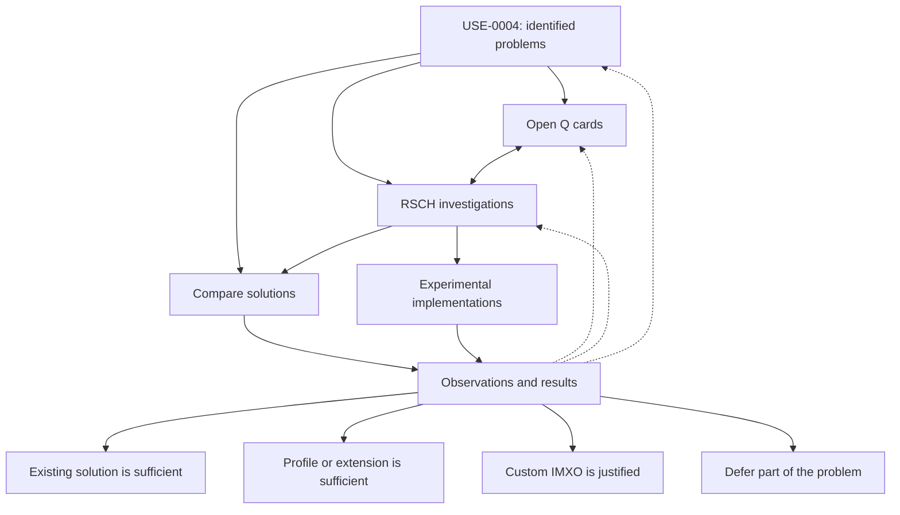

*Figure 4.12 — Interrelated questions, research, and possible outcomes. This is not a mandatory linear process.*

No outcome is preferred or mandatory in advance. Comparison may show that an existing container is sufficient while a new logical model remains useful. Scheduling and prioritization remain in the project plan.

## 46. Related artifacts and external foundations

### 46.1. Related use cases

- [`USE-0001`](USE-0001-structured-screenshot-content.md) — permissible acquisition and preservation of structured screenshot content;
- [`USE-0002`](USE-0002-safe-sanitization.md) — intentional sanitization, distinct from ordinary editing;
- [`USE-0003`](USE-0003-structured-screenshot-ai-input.md) — interpretation of a structured screenshot by an AI consumer.

### 46.2. Open questions

- [`Q-0002`](../project/questions/Q-0002-physical-file-structure.md) — physical model;
- [`Q-0003`](../project/questions/Q-0003-logical-object-model.md) — objects and relationships;
- [`Q-0007`](../project/questions/Q-0007-provenance-model.md) — provenance;
- [`Q-0008`](../project/questions/Q-0008-integrity-trust-model.md) — integrity and trust;
- [`Q-0009`](../project/questions/Q-0009-cv-annotations.md) — CV annotations;
- [`Q-0010`](../project/questions/Q-0010-accessibility-model.md) — accessibility;
- [`Q-0011`](../project/questions/Q-0011-sdk-integrations.md) — SDK;
- [`Q-0012`](../project/questions/Q-0012-conformance-model.md) — conformance;
- [`Q-0014`](../project/questions/Q-0014-safe-editing-cascade-operations.md) — safe editing and dependencies.

### 46.3. Related research

- [`RSCH-0001`](../research/RSCH-0001-container-architecture-comparison.md) — containers;
- [`RSCH-0002`](../research/RSCH-0002-safe-physical-file-updates.md) — safe writing;
- [`RSCH-0003`](../research/RSCH-0003-text-layer-models.md) — text-layer model;
- [`RSCH-0004`](../research/RSCH-0004-object-relationships-alternative-assertions.md) — relationships;
- [`RSCH-0005`](../research/RSCH-0005-provenance-transformation-chains.md) — provenance;
- [`RSCH-0006`](../research/RSCH-0006-integrity-consistency-trust-boundaries.md) — integrity;
- [`RSCH-0007`](../research/RSCH-0007-structured-file-sanitization.md) — sanitization as a scenario boundary;
- [`RSCH-0009`](../research/RSCH-0009-partial-representations-selective-extraction.md) — partial representations;
- [`RSCH-0012`](../research/RSCH-0012-cv-annotation-interchange-formats.md) — CV markup interchange.

The research cards are `DRAFT` at publication of this USE; links do not imply completed findings. No approved `REQ`, `DES`, `ADR`, or `SPEC` is directly derived from this USE.

### 46.4. External standards and specifications

- [PNG Specification, Third Edition — W3C Recommendation](https://www.w3.org/TR/png-3/) — chunk structure and `safe-to-copy`.
- [SVG 2 — W3C Candidate Recommendation Snapshot](https://www.w3.org/TR/SVG2/) — mixed graphics and modes including Secure Static.
- [Web Annotation Data Model — W3C Recommendation](https://www.w3.org/TR/annotation-model/) — annotations, selectors, and resource state.
- [Web Annotation Selectors and States — W3C Working Group Note](https://www.w3.org/TR/selectors-states/) — supplementary material on selectors and states; do not describe it as a Recommendation.
- [OpenRaster](https://www.openraster.org/) — layered interchange format; distinguish the standard from editor capabilities.
- [ISO/IEC 19566-5:2023 — JUMBF](https://www.iso.org/standard/84635.html) — base JUMBF standard.
- [ISO/IEC 19566-5:2023/Amd 1:2025 — JUMBF Box Compression and Standalone JUMBF Files](https://webstore.iec.ch/en/publication/106543) — published amendment.
- [JPEG XL — JPEG Committee](https://jpeg.org/jpegxl/) — encoding and container representations.
- [C2PA Technical Specification](https://spec.c2pa.org/) — provenance and verifiable assertions.

This list frames research questions and is not a completed survey. Publication status and revisions of external standards should be rechecked when used. Specification capability, application support, and cross-application interoperability must not be conflated.

### 46.5. Relationship to the research plan

Observations from this USE provide questions and test examples for the existing [`research-plan.md`](../project/research-plan.md). Do not create a parallel plan, assign schedules, or declare work complete merely because links exist.

## 47. Conclusion, rejected assumptions, and review grounds

### 47.1. Central observation

Editing a structured image changes more than pixels. Text, regions, relationships, provenance, classifications, and rendering conditions may change independently and need not retain the same applicability. Retaining a record does not prove it current, and a technically correct transformation does not prove semantic truth.

### 47.2. Universal assumptions not adopted

The following are not accepted as universally true: one file guarantees consistency; existing formats cannot store additional data; a new container is always better; a shared semantic model requires new packaging; geometric overlap proves dependency; common provenance proves independent confirmation; a matching hash proves truth; an unknown block must always be deleted or always retained; every editor must rerun OCR/CV; complete history is mandatory; or successful opening proves identical rendering.

Also rejected as universal strategies are unconditional inheritance of all annotations, wholesale removal of unknown structure, treating every uncertainty as an error, equating ordinary cropping with sanitization, a single numerical `trust score`, and embedded executable behavior.

### 47.3. Possible research outcomes

Research may find that (1) a custom IMXO is technically justified; (2) an existing container with a shared model is sufficient; (3) a profile or extension of an existing standard is sufficient; (4) a separate annotation representation is preferable; or (5) some functionality should be deferred. Outcomes may differ by task.

**“No new container is needed” is a valid research finding.** The scenario does not itself prove the need for a custom binary structure, a universal object graph, mandatory history, or the economic value of creating a new format.

### 47.4. Grounds for review

New operation types, confirmed defects, independent prototype results, changes to external standards, quantitative data, and new security boundaries may justify revising this scenario. Material changes follow PREP-08; history must not be rewritten retroactively.

### 47.5. Final conclusion

**The primary result of USE-0004 is a testable formulation of consistent structured-image editing, not a claim that a complete technical solution already exists.** Required properties should be investigated separately at the levels of logical model, packaging, and real application behavior.

## Supersession

**Supersedes:** none  
**Superseded by:** none

## History

- 2026-10-28 — card published in the English documentation tree as `DRAFT / CANDIDATE`; a separate verbatim early source for §§1–20 was not found in the working tree or repository history, the author-provided SVG was localized for Figure 4.4, and local links were checked.

