# USE-0004 — Редактирование структурированного изображения с сохранением согласованности представлений

**Status:** DRAFT  
**Disposition:** CANDIDATE  
**Created:** 2026-10-27  
**Updated:** 2026-10-28  
**Type:** Informative use case

> `USE-0004` — информативное описание сценария применения IMXO, а не нормативная спецификация, обязательный алгоритм редактора, готовая модель объектов или доказательство необходимости собственного контейнера. Формат v0.1 статический и пассивный: без JavaScript, макросов, событий, исполняемых сценариев, анимационной логики и автоматических сетевых запросов. Нормативные решения принимаются отдельно в `REQ`, `DES`, `ADR` и `SPEC` после исследований.
>
> **Редакционная пометка:** разделы 1–20 и рисунки 4.1–4.3, 4.5–4.6 представлены в восстановленной связной редакции, поскольку отдельный дословный утверждённый исходник этих блоков не был найден в рабочем дереве или истории репозитория при публикации. Этот текст не объявляется дословным оригиналом и остаётся предметом авторского review. Это не влияет на информативный статус сценария. Разделы 21–47 объединяют согласованные решения последующих проходов с их сквозной терминологической правкой.

## Содержание

- **Блок 1, §§1–10.** Акторы, проблема, условия применения, области применимости и полноты.
- **Блок 2, §§11–20.** Операции редактирования, текст, экспорт и история рабочего состояния.
- **Блок 3, §§21–30.** Идентичность, отношения, происхождение, применимость и каскадные последствия.
- **Блок 4, §§31–40.** Завершение, ошибки, безопасность, проверка, совместимость и приватность.
- **Блок 5, §§41–47.** Альтернативы, сравнение, гипотезы, исследования и итоги.

## 1. Участники и системы

Основной участник — человек или программа, изменяющие существующее структурированное изображение либо создающие его производное состояние. В сценарии могут участвовать графический редактор, средство редактирования OCR и семантических аннотаций, просмотрщик с возможностями изменения, система компьютерного зрения, средство автоматизированной обработки, экспортёр, валидатор и конечный потребитель.

Создатель файла, автор отдельных аннотаций, исполнитель редактирования и потребитель результата не обязательно совпадают. Изображение может содержать утверждения нескольких источников. Редактор может поддерживать лишь часть таких данных и не иметь доступа к исходной программе, прежним состояниям или внешним доказательствам происхождения.

Цель сценария не заключается в том, чтобы обязать все приложения выполнять одинаковые операции. Важен анализ того, какие свойства результата можно обоснованно сохранить или подтвердить в пределах конкретной задачи.

## 2. Контекст

IMXO рассматривается как возможное переносимое представление визуального содержимого вместе с текстом, областями, масками, аннотациями, отношениями и дополнительными сведениями. В процессе последующего редактирования эти представления могут изменяться неодинаково.

Обычное редактирование растра может разрушить соответствие ранее созданной разметки итоговой картинке. Изменение вектора может поменять видимость, порядок наложения и пространственные отношения. Исправление OCR либо альтернативного описания, напротив, может не менять пиксели вообще. Экспорт в менее выразительный формат может сознательно исключить большую часть структуры.

Исходный файл не предполагается безошибочным, полностью структурированным или созданным доверенным инструментом. Отсутствие сведений о происхождении, предшествующих состояниях и неизвестных расширениях является реалистичным исходным условием.

## 3. Проблема и потребность

При изменении одного представления изображения другие представления могут остаться технически сохранными, но начать описывать неверное состояние. При этом нельзя считать все отношения одинаковыми: пересечение областей не обязательно означает семантическую зависимость, а общего происхождения недостаточно для автоматического пересчёта утверждений.

Нужно исследовать, какие свойства могут сохраняться после редактирования, когда требуется дополнительная обработка, как отличать установленное нарушение от отсутствия сведений и как передавать существенные ограничения следующей программе. Нельзя решать проблему безусловным удалением всей неизвестной структуры либо требованием универсального распознавания и доказательства истины.

## 4. Цель

Рассмотреть возможность обычного редактирования структурированного изображения с учётом доступных связей между графикой, текстом, областями и утверждениями, не подменяя техническое сохранение данных утверждением об их смысловой применимости.

Важны раздельная оценка пользовательского результата, сохранившейся структуры, качества геометрических преобразований, известных ограничений, частичной поддержки и возможности дальнейшего использования другими реализациями. Это исследуемые ожидания USE, а не готовые требования к IMXO.

## 5. Инициирование

Сценарий начинается, когда пользователь или внешняя система открывает изображение для изменения, исправляет ошибочный распознанный текст, редактирует аннотации, перемещает или копирует изображённое содержимое, обрезает композицию, изменяет свойства вектора либо готовит экспорт. Операция может выполняться вручную, пакетно или средствами другого приложения.

Инициирование не предполагает обязательного изменения исходного файла: результатом может стать отдельная копия, производное IMXO или экспортированное представление.

## 6. Основной сценарий

1. Редактор получает файл и определяет известную ему часть его визуального и структурированного содержимого.
2. Устанавливаются намерение операции и существенные условия результата, например необходимость сохранить определённые аннотации.
3. Выполняется изменение графики, структуры, текста, отношений, свойств отображения либо их сочетания.
4. Для доступных зависимостей рассматриваются последствия изменения; неизвестные зависимости не объявляются автоматически отсутствующими.
5. Обрабатываются поддерживаемые сведения. Для остальных остаются возможными сохранение с ограничением, исключение из определённого результата или отказ — в зависимости от задачи.
6. Формируется новое рабочее состояние, а затем при необходимости сохраняется конкретный файл или отдельный экспорт.
7. Отдельные свойства могут быть проверены в определённых пределах. Получатель использует фактически переданные сведения со своими возможностями чтения.

Это логическая последовательность сценария, а не обязательная архитектура редактора. В реальной реализации проверки могут происходить раньше, позже и неоднократно.

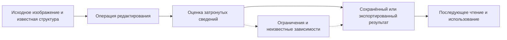

*Рис. 4.1 — Основной сценарий редактирования структурированного изображения. Схема иллюстративна и не задаёт обязательный конвейер обработки.*

## 7. Область сценария

В область входят обычное изменение растра и вектора, редактирование текста и аннотаций, перемещение, копирование, частичное вырезание, разделение, объединение, изменение масштаба, поворот, обрезка, перекрытие, перераспределение видимости, сохранение и экспорт. Рассматриваются идентичность, геометрия, семантические утверждения, происхождение, несколько аннотаторов, зависимости, частичная поддержка, неизвестность, проверка и риски ошибок.

Не предполагается, что каждый редактор способен выполнить каждую операцию или гарантировать смысловую истинность утверждений. Рассматриваются как интерактивные, так и автоматизированные преобразования.

## 8. Вне области сценария

Не входят проектирование конкретного бинарного контейнера, структуры полей, алгоритма универсальной проверки истинности, обязательной истории изменений, криптографической инфраструктуры, единого протокола редакторов, внешней системы управления агентами и механизмов сетевого разрешения ссылок.

**Санитизация** — отдельный `USE-0002`: обычное скрытие или обрезка не обещает удаления выбранной информации из всех относящихся к ней сохраняемых представлений. Допустимость первоначального захвата скрытых значений приложения ограничивается `USE-0001`. Использование сведений ИИ и осуществление действий агентами раскрываются в `USE-0003`.

Сценарий относится к статическому изображению и не вводит временную модель видео.

## 9. Входные данные и условия

Входом может быть IMXO с известной или частично неизвестной структурой, импортированное изображение с разметкой, файл с несколькими наборами утверждений или производное изображение. Некоторые сведения могут быть получены средствами OCR/CV, людьми, исходным приложением или неизвестным источником.

Исходное состояние может содержать: неверные аннотации, рассогласованные области, неизвестные расширения, подписи и хэши с определённой областью действия, скрытые графические слои, альтернативные представления и исторические сведения. Они не предполагаются обязательными элементами любого файла.

Операция может иметь существенные условия: сохранить редактируемость, не терять определённые аннотации, получить пригодное только визуальное представление или не затрагивать исходник. Результат оценивается относительно этих условий.

## 10. Применимость, полнота, проверенность и эксплуатационный профиль

### 10.1. Независимые характеристики

**Наличие:** содержится ли определённая запись в рассматриваемом файле или представлении. **Применимость:** относится ли утверждение к соответствующему состоянию и свойству изображения. **Достоверность:** имеются ли основания считать его истинным. **Структурная согласованность:** корректны ли известные отношения и ссылки. **Проверенность:** какие именно свойства и состояния проверялись. Эти характеристики не являются обязательными полями IMXO и могут иметь различающиеся результаты.

Применимость может быть установлена, опровергнута либо остаться неизвестной. Отсутствие проверки не означает ошибки; сохранность записи не доказывает её применимости.

### 10.2. Полнота относительно определённой области

Различаются полнота исходных сведений относительно задачи, полнота прочитанной части файла, полнота обработки затронутых отношений, полнота результирующего представления и полнота проверки. Полная обработка всего известного редактору содержимого не доказывает полной обработки неизвестных расширений.

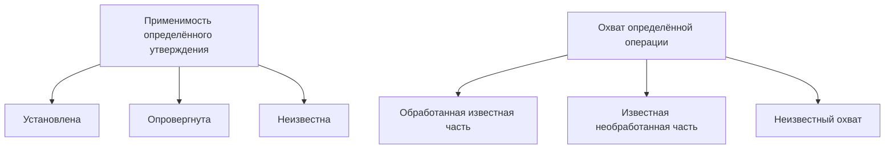

*Рис. 4.2 — Независимые оси применимости утверждения и охвата обработки. Это аналитические различия, не нормативные перечисления статусов.*

### 10.3. Контексты преобразования

Различаются **исходный контекст** (полученные данные и исходные знания), **рабочий контекст** (состояние редактирования), **сохранённый контекст** (конкретные записанные данные) и **контекст получателя** (что последующая программа фактически получила и поняла).

Знание редактора не обязательно записывается в файл. Записанная структура не обязательно полностью читается получателем. Это не требование хранить четыре состояния внутри IMXO.

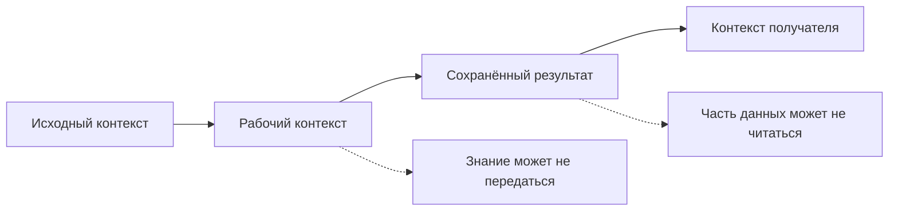

*Рис. 4.3 — Четыре контекста оценки результата. Диаграмма описывает наблюдаемые границы, а не обязательную историю состояний.*

### 10.4. Эксплуатационный профиль

Операции могут быть интерактивными либо пакетными, единичными либо повторяемыми. Типичные размеры, число областей, число аннотаторов, пиковые нагрузки и частота редактирования — **не установлены; требуют исследования**. Реалистичность ручной проверки зависит от объёма и назначения данных. Ресурсоёмкость важна, но нормативные пороги не определены.

Ожидаемый полезный срок результата варьируется от кратковременного рабочего файла до длительно сохраняемого изображения. Конкретные сроки хранения, горизонт проверки происхождения и допустимость внешних зависимостей — **не определены для общего сценария**. Автономное чтение может быть существенно, но необходимость полного автономного доказательства всех утверждений не предполагается.

## 11. Общие операции редактирования

Операции отличаются по тому, что именно изменяется: данные изображения, пространственная привязка, структура аннотаций, значения утверждений, композиция или только условия отображения. Одинаковое геометрическое действие над целым объектом и над его фрагментом может иметь разные смысловые последствия.

### 11.1. Перемещение целого элемента

Известное преобразование может позволять пересчитать координаты рамок и масок, связанных с самостоятельным элементом. Но прежние утверждения о его отношении к окружению могут стать неприменимыми. Не всякий распознанный объект существует как отдельный редактируемый графический элемент: он может быть лишь частью общего растра.

### 11.2. Копирование и частичное выделение

Копирование создаёт новый графический экземпляр, но не новое независимое наблюдение реального мира. Частичное выделение и перенос могут оставлять геометрически корректный фрагмент, к которому категория прежнего целого не применима. Неизвестность нельзя скрывать автоматическим наследованием всех аннотаций.

### 11.3. Пример частичного перемещения автомобиля

При вырезании и переносе передней части изображения автомобиля новый фрагмент не обязан становиться самостоятельной сущностью категории «автомобиль». Исходная область может утратить прежний смысл. Известная связь фрагмента с первоначальным изображением не доказывает наличия самостоятельного нового автомобиля.

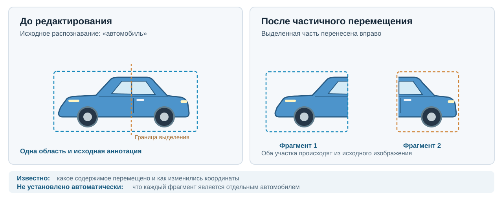

*Рис. 4.4 — Частичное перемещение автомобиля: корректное геометрическое преобразование не подтверждает сохранение исходной классификации для каждого фрагмента. При публикации используется исходный SVG; PNG не добавляется.*

### 11.4. Разделение и соединение

Разделение изображения на несколько областей не обязательно означает появление нескольких изображённых объектов. Объединение фрагментов разных источников не доказывает появления единого реального референта. Для обоих случаев существенны исходные утверждения, их область и доступная информация о преобразовании.

## 12. Масштабирование, поворот и координаты

Геометрические преобразования могут применяться к прямоугольникам, многоугольникам, точкам и маскам различным образом. Преобразование координат может быть определённым математически, но корректность результата зависит также от используемой системы координат, округления, границ и формы области.

Маска, подходившая к исходному растру, не обязательно корректна после нелинейной деформации. Поворот может изменить ограничивающий прямоугольник без изменения смысловой категории. Изменение масштаба может повлиять на распознаваемость мелкого текста. Здесь не устанавливаются нормативные координатные системы или способы интерполяции: их следует исследовать позднее.

## 13. Изменение изображения и изменение семантических сведений

Следует отличать графическое преобразование от изменения отдельного утверждения. Если пользователь исправляет категорию объекта без изменения изображения, это полноценное структурное редактирование. Если пользователь заменяет нарисованный текст, это графическое изменение, способное затронуть OCR и текстовые описания.

### 13.1. Правка аннотации

Пользователь может исправить ошибочное имя объекта или добавить новое описание. При этом необходимо различать исправление прежнего значения и создание нового независимого утверждения. Внешняя программа не обязана считать новую запись истинной только потому, что она появилась в файле.

### 13.2. Правка пикселей

Локальное перекрашивание, ретуширование либо закрашивание фрагмента может затронуть классификацию, OCR, маски, геометрию и пространственные отношения. Нельзя сделать вывод об отсутствии воздействия лишь на основании того, что прямоугольник аннотации сохранился.

### 13.3. Новые утверждения после анализа

После редактирования пользователь может запустить OCR, CV или ИИ-проверку и добавить новую разметку. Такой результат имеет собственное происхождение и не обязан заменять все альтернативные утверждения. Встроенная обязанность автоматически запускать такой анализ не предполагается.

### 13.4. Иллюстрация вариантов

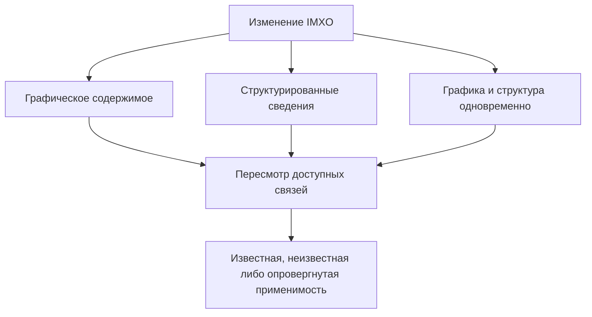

*Рис. 4.5 — Разные виды редакторских операций и их возможные последствия для сведений.*

## 14. Обрезка, перекрытие и видимость

Обрезка может менять только видимую область, а может физически исключать графические данные — в зависимости от операции и редактора. Перекрытие непрозрачным объектом может сделать прежние пиксели невидимыми, не уничтожая их. Эти случаи не эквивалентны безопасному удалению содержимого.

Аннотация о целиком видимом автомобиле может утратить применимость после добавления перекрытия, хотя байты самого автомобиля остаются прежними. Остаточная разметка скрытой области может оставаться в файле; её допустимость зависит от цели операции и условий передачи.

## 15. Стирание и удаление при обычном редактировании

Удаление графического элемента, удаление аннотации и удаление связанных данных могут иметь разные последствия. Удаление отдельной записи не обязательно означает исключение соответствующей информации из растра и других представлений. При этом автоматическое удаление всех геометрически пересекающихся аннотаций может уничтожить независимую полезную информацию.

Если пользователь требует именно санитизации, применяются отдельные ожидания `USE-0002` относительно выбранного содержимого и известных производных/остаточных структур. Обычное редактирование само по себе таких гарантий не обещает.

## 16. Вектор, текст и шрифты

Редактирование векторного элемента может сохранить его самостоятельность либо привести к растеризации. Текст может существовать как редактируемое символьное содержимое, векторные контуры, растр или отдельное OCR-утверждение. Эти представления не взаимозаменяемы во всех задачах.

Различаются: исправление результата распознавания, добавление пользовательского описания, изменение семантической категории и изменение непосредственно видимой надписи. Например, изменение OCR `B` на `8` не меняет пиксели, а изменение графического текста может потребовать пересмотра OCR.

Необходимо учитывать разные шрифты, подстановку отсутствующих глифов, оформление, цвет, переносы и многоязычный текст. Встроенный шрифт и эталонный механизм рендеринга не предписываются. Невидимое в растре допустимое доступное описание также не следует автоматически считать ошибкой.

## 17. Сохранение, экспорт и обмен

Сохранение изменённого IMXO и экспорт в другой формат являются разными операциями. При экспорте в простой растр может исчезнуть почти вся структура, и это может быть приемлемо для одной задачи и неприемлемо для другой. При экспорте в PDF, SVG или другую структуру некоторые аннотации могут перенестись, а другие — изменить смысл или потеряться.

### 17.1. Выразительность целевого формата

Физическое сохранение текста не обязательно сохраняет правильную область, происхождение или ограничение его применимости. При выборе представления нужно оценивать не только байты, но и доступный получателю контекст.

### 17.2. Частичная поддержка

Неподдерживаемые данные могут быть сохранены непрозрачно, исключены из отдельного экспорта или привести к отказу от получения результата с необходимыми свойствами. Универсальная стратегия здесь не устанавливается.

### 17.3. Редактируемость после экспорта

Графика может выглядеть одинаково до и после экспорта, но перестать быть редактируемой как набор независимых элементов. Сохранение внешнего вида не доказывает сохранения структуры.

### 17.4. Иллюстрация границ экспорта

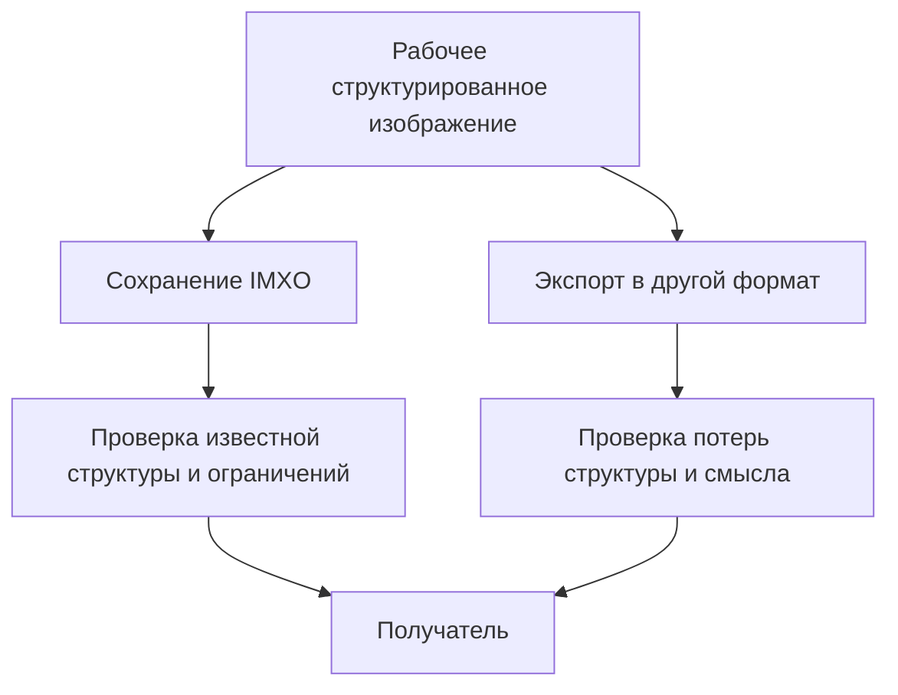

*Рис. 4.6 — Сохранение IMXO и экспорт могут иметь разные пределы полноты и проверки.*

## 18. Отмена, повтор и прежние состояния

Внутренние функции undo/redo могут существовать в редакторе без сохранения истории внутри IMXO. Отмена рабочего действия, возвращение прежнего файла и наличие хранимой истории — разные механизмы. Из факта доступности undo нельзя делать вывод о восстановимости предыдущих значений получателем.

Сохранение происхождения не требует автоматически хранить прежние пиксели, текст, чувствительные значения или полные версии объекта. Предыдущий контекст может быть известным, частично известным или недоступным.

## 19. Несколько аннотаторов и источников

Разные участники могут описывать одно изображённое содержимое разными словами, масками и областями. Их утверждения могут быть альтернативными, совместимыми или противоречащими при известных условиях. Нельзя объявлять противоречием любое различие классификаций.

Несколько процессов, использующих один исходный ошибочный результат, не создают автоматически независимых подтверждений. Оценки уверенности разных анализаторов могут иметь несопоставимые шкалы. Происхождение является полезным контекстом, но само по себе не доказывает истинность утверждения.

## 20. Возможные исходы и границы обработки

При изменении структурированного изображения могут рассматриваться преобразование известных данных, сохранение определённых записей, сохранение с известным ограничением, исключение из результата, изменение условий операции либо отказ от формирования результата с заданными свойствами.

**Возможный исход не является автоматически успешным для любой задачи.** Если требовалось сохранить все аннотации, их молчаливое исключение может нарушить существенные условия операции. Если требовался только визуальный экспорт, отсутствие структуры может быть ожидаемым.

Важно различать успешное выполнение отдельного преобразования, полноту обработки известных данных, фактическое сохранение и пригодность для следующего потребителя. Невозможность оценить семантическое свойство не является доказательством его неправильности. Результат с известной неопределённостью нельзя без оснований представлять как полностью проверенный.

## 21. Идентичность описываемого содержимого

Идентичность после изменения может относиться к преемственности графического элемента, тождеству изображённой сущности, предполагаемому реальному референту или определённому утверждению. Это аналитически разные вопросы. Копия нарисованного автомобиля — новый графический экземпляр, но не обязательно новое изображённое физическое транспортное средство. А повторная аннотация «автомобиль» может быть производной прежней записи, а не самостоятельным наблюдением.

### 21.1. Графическое представление

Редактор, знающий исходный элемент и преобразование, иногда способен проследить его преемственность. Однако часть целого растра, распознанная как автомобиль, не обязательно является самостоятельным графическим элементом. Отрезание половины объекта либо объединение разных источников усложняет утверждение о тождестве.

### 21.2. Изображённая сущность и референт

Несколько областей могут описывать одну сцену или разные сущности; художественное, синтетическое и схематическое изображение может не иметь установленного физического референта. Совпадение класса, цвета или формы не доказывает тождество реального объекта.

### 21.3. Преемственность утверждения

Известно, что аннотация скопирована из другой записи, — значит, можно установить преемственность записи, но не истинность исходного текста. Если исходная аннотация ошибочна, корректное копирование сохраняет ошибку. Без сведений о предыдущем состоянии идентичность и исходный контекст могут оставаться неизвестными.

### 21.4. Граница будущей модели

Здесь не устанавливаются обязательные глобальные идентификаторы, правила их смены при копировании или механизм полной истории. **Идентичность нельзя универсально выводить из геометрии, общего происхождения или совпадения категорий.**

## 22. Объекты, области и множественные представления

Графические данные, пространственная область и утверждение о содержимом не всегда образуют отношение «один к одному». Одна область может иметь несколько описаний; одно утверждение — относиться к нескольким областям; один векторный элемент — не иметь семантических аннотаций. Разные источники могут выделять одну сущность разными рамками и масками.

### 22.1. Графика и аннотации

Автомобиль может быть частью общего растра и не существовать как отдельный редактируемый элемент. Аннотация колеса может пересекаться с аннотацией дороги, но само пересечение не доказывает отношения «часть–целое». Геометрическая вложенность также не является универсальным семантическим отношением.

### 22.2. Видимое и сохраняемое

В редактируемом файле может содержаться графический элемент, скрытый маской или другим слоем. Это отличается от невидимого внутреннего состояния исходного приложения, которое не было частью допустимого пользовательского представления при создании снимка. Возможность редактировать скрытое содержимое внутри файла не разрешает автоматически захватывать скрытые значения приложения.

### 22.3. Множественные связи

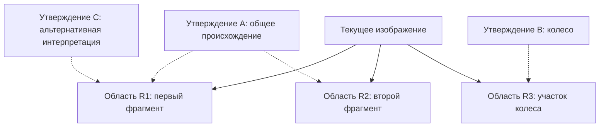

*Рис. 4.7 — Несколько областей и утверждений. Обозначения условны, а отсутствие линии между областями не доказывает отсутствие любого отношения.*

### 22.4. Вывод

Для исследования нужно различать графические элементы, области и утверждения, **не принимая заранее обязательный перечень классов объектов IMXO**.

## 23. Отношения, происхождение и зависимости актуальности

**Отношение** описывает определённую связь; **происхождение** — источник данных или преобразование; **зависимость актуальности** — возможное влияние изменения на применимость определённого свойства. Они могут совпадать в частных случаях, но не тождественны.

| Отношение | Пример | Чего оно не доказывает |
|---|---|---|
| Пространственное | Автомобиль слева от здания | Независимость от будущего перемещения |
| Часть–целое | Колесо относится к автомобилю | Возможность вывести эту связь из пересечения рамок |
| Структурное | Ссылка или членство в группе | Истинность семантической категории |
| Производное | Аннотация получена из OCR | Необходимость одинакового изменения обеих записей |
| Происхождение | Данные получены от источника | Его достоверность и независимость |

Зависимость следует анализировать относительно **конкретного свойства и преобразования**. Изменение цвета может затронуть утверждение «красный», но не обязательно категорию «автомобиль». Перемещение может затронуть отношение «слева от здания», не изменив символы номера.

Актуальность может зависеть также от композиции. Если автомобиль не изменён, но поверх него помещена непрозрачная фигура, утверждение «полностью виден» может стать неверным. Известная ссылка, неустановленная связь и отсутствие воздействия — разные состояния знания. Отсутствие явной связи не является доказательством отсутствия любой зависимости.

## 24. Изменение отношений после операций

При перемещении объекта может измениться его отношение к внешнему окружению, хотя внутренняя классификация сохранит применимость. При копировании отношения исходного экземпляра с окружением не обязаны переноситься на копию. При разделении наличие общего происхождения частей не доказывает существования нескольких семантических объектов.

При объединении фрагментов может возникнуть новый визуальный результат, но единый реальный референт не обязательно существует. Групповое перемещение может сохранять одни относительные положения и изменять другие, особенно при дополнительных поворотах или масштабировании. Наложение маски может изменить видимость без изменения исходных пикселей.

Исходная аннотация могла быть ошибочной до изменения; поэтому нельзя объявлять результат неверным исключительно из-за несоответствия прежней записи, не исследовав её контекст. Если прежние отношения не хранились, восстановить их по текущему изображению бывает невозможно.

**Вывод:** последствия определяются доступными сведениями об операции, конкретными отношениями и свойствами, а не универсальной схемой «переместить все связанные данные».

## 25. Контекст, применимость и составные аннотации

**Исходный контекст** — состояние, относительно которого утверждение было создано; **текущий контекст** — рассматриваемое состояние после изменения; **контекст использования** — сведения и цели потребителя. Они могут быть неполными и не обязаны храниться полностью в файле.

### 25.1. Три разных утверждения о прошлом

Различаются (а) известно, к какому контексту относилась запись; (б) известно, что она тогда утверждала; (в) подтверждено, что она была правильной. Первые два обстоятельства не доказывают третье. Запись «автомобиль» могла существовать до редактирования и быть ошибочной с самого начала.

### 25.2. Сохранение записи и использование

Сохранённая историческая запись не становится автоматически подтверждённой актуальной аннотацией текущего изображения. Возможность корректной интерпретации зависит от того, способен ли файл передать нужное ограничение и понимает ли его получатель. Если ограничение исчезнет при экспорте, сохранение старого значения может исказить смысл результата.

### 25.3. Отдельные свойства аннотации

| Свойство | Возможные последствия |
|---|---|
| Геометрия | Может преобразоваться математически |
| Категория | Может остаться применимой, утратить её или стать неизвестной |
| Уверенность анализатора | Может оставаться сведением о первоначальном вычислении, но не оценкой нового состояния |
| Пространственные отношения | Могут измениться при перемещении |
| Происхождение | Может сохраниться как исторический факт или утверждение об источнике |
| Видимость | Может измениться при перекрытии |

Это не нормативное требование хранить каждое свойство отдельным объектом.

### 25.4. Граница с санитизацией

В обычном редактировании запись с историческим контекстом потенциально может сохраняться. В операции санитизации выбранное удаляемое содержание не должно сохраняться в конечном файле только потому, что его назвали историческим. Подробные условия относятся к `USE-0002`.

## 26. Аннотации разных источников, альтернативы и противоречия

Следует различать разные записи, разных авторов, разные процессы и доказанную независимость оснований. Два анализатора могут использовать один исходный OCR, общую модель или одинаковые ошибочные данные. Повторное вычисление и копирование не обязательно создают независимые свидетельства.

«Транспортное средство», «автомобиль» и «грузовой автомобиль» могут быть совместимыми классификациями. «Автомобиль» и «велосипед» внутри одной большой области тоже не обязательно противоречат друг другу: они могут относиться к разным объектам. Настоящее противоречие требует сопоставления предмета, свойства, области, контекста, времени и классификационной системы. Если их нельзя установить, конфликт может остаться неизвестным.

Оценки уверенности разных моделей не обязаны быть напрямую сопоставимыми: `0.92` одного алгоритма не является универсально более сильным доказательством, чем `0.75` другого.

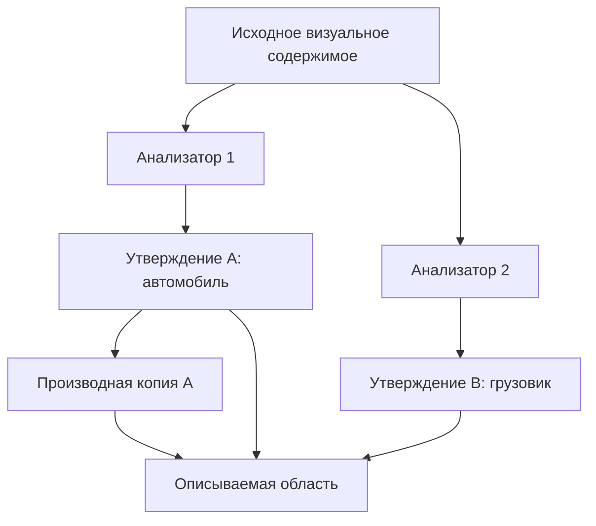

*Рис. 4.8 — Отдельные утверждения и производная запись. Схема не подтверждает независимость двух анализаторов и не объявляет их классификации противоречащими.*

## 27. Зависимости и каскадные последствия

Каскадное **воздействие** означает, что изменение может затронуть другие сведения; каскадное **удаление** — только один возможный результат обработки. Прежний OCR регистрационного номера может утратить применимость после замены символов; геометрия той же области может потребовать пересчёта при переносе. При этом общая аннотация «автомобиль» может оставаться пригодной, хотя её проверка не становится автоматической.

### 27.1. Известное и возможное воздействие

Наличие проверяемой зависимости отличается от предположения о возможном воздействии и отсутствия установленного влияния. Последнее не является доказательством абсолютной независимости.

### 27.2. Влияние композиции

Непосредственный источник аннотации может не измениться, а результат отображения — измениться вследствие маски, порядка слоёв или прозрачности. Это важно для утверждений о видимости, положении и свойствах композиции.

### 27.3. Циклы

Цикл структурных ссылок A→B→A не означает автоматически циклическую зависимость актуальности. Цепочки происхождения — ещё один вид отношений, который не следует смешивать с предыдущими. Универсальный механизм разрешения циклов здесь не выбирается.

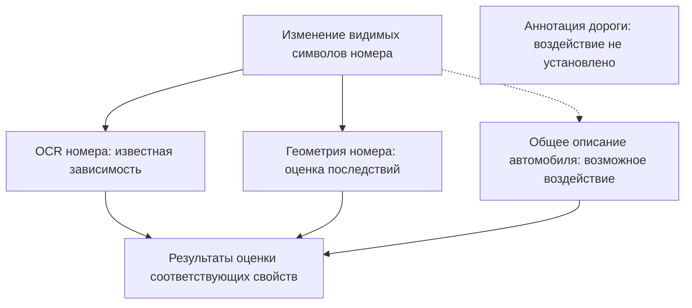

*Рис. 4.9 — Известные зависимости, возможное воздействие и сведения без установленного воздействия. Аннотация дороги не объявляется доказанно независимой.*

### 27.4. Структура и смысл

Ссылка может разрешаться на существующий идентификатор, но обозначать неверный объект после преобразования. Поэтому физическая корректность, структурная связность, правильность смысловой привязки и истинность классификации оцениваются раздельно.

## 28. Происхождение, целостность, доверие и приватность

Запись о происхождении является утверждением и может быть ложной либо неполной. Известный источник не подтверждает истинность его результата. Необходимо различать наличие записи, целостность её содержания и достоверность описанного события.

Проверка целостности имеет область действия. Хэш отдельного блока может совпадать после изменения другого содержимого, но это не подтверждает сохранение семантической связи. Хэш аннотации «автомобиль» может соответствовать байтам текста, в то время как его ссылка указывает уже на иную область. Подпись определённого состояния не обязательно подтверждает все более поздние преобразования.

Происхождение может содержать чувствительные сведения — пути к исходникам, идентификаторы пользователей, прежние значения, хэши удалённых данных. Не следует автоматически собирать их ради полноты истории. При санитизации такое служебное происхождение не получает исключения, если оно сохраняет выбранное удаляемое содержание.

**Вывод:** целостность значения, связь, применимость, истинность, доверие и приватность — независимые свойства. Единая числовая оценка «доверия ко всему файлу» здесь не предлагается.

## 29. Частичная поддержка и потеря контекста

Редактор может полностью понимать некоторую структуру, видеть другой блок без понимания его семантики либо не знать о существовании определённых зависимостей. Побайтовое сохранение непрозрачного блока не доказывает применимость его данных к изменённому изображению. Безусловное удаление тоже может нарушить другие отношения и уничтожить полезные сведения.

### 29.1. Смысловая потеря без потери данных

Редактор A может установить, что классификация после обрезки не подтверждена, но экспортировать категорию без ограничения. Редактор B тогда получит «автомобиль» как обычную аннотацию. Данные сохранены, однако смысл исходного утверждения для получателя изменился. Эта проблема шире простого нераспознавания неизвестного блока.

### 29.2. Разные уровни корректности

Следует различать синтаксическую читаемость, структурную согласованность, корректность смысловой привязки, применимость и полноту переданных ограничений. Ни один уровень не доказывает остальные.

### 29.3. Пределы заявляемого результата

В зависимости от существенных условий могут рассматриваться ограниченное сохранение, преобразование, исключение или невозможность завершить операцию с заданными свойствами. Если ограничение нельзя представить получателю, молчаливое сохранение прежней аннотации может быть неприемлемым. Но формат USE не задаёт обязательных кодов ошибок либо выбора механизма.

## 30. Семантические проверочные случаи

Этот раздел проверяет идентичность, отношения, контекст, альтернативные аннотации и смысловые последствия. Технические отказы записи, совместимость реализаций и безопасность разбора рассматриваются в §40. Ниже исследовательские случаи, не нормативные тесты соответствия.

| № | Случай | Исследуемое различие |
|---|---|---|
| 1 | Перемещение целого автомобиля | Геометрия и классификация |
| 2 | Копирование автомобиля | Графический экземпляр и референт |
| 3 | Частичное перемещение автомобиля | Фрагмент и семантическая сущность |
| 4 | Объединение изображений разных источников | Композиция и происхождение |
| 5 | Пересекающиеся аннотации | Геометрия и смысловые отношения |
| 6 | Изменение символов номера | OCR, геометрия и содержание |
| 7 | Изменение категории объекта | Запись и достоверность |
| 8 | Два разных анализатора | Источники и независимость оснований |
| 9 | Копии одной аннотации | Производность и наблюдение |
| 10 | Составная аннотация после перемещения | Применимость отдельных свойств |
| 11 | Одно утверждение о нескольких областях | Множественные представления |
| 12 | Циклические структурные отношения | Ссылки и зависимости актуальности |
| 13 | Ложное происхождение | Наличие записи и достоверность |
| 14 | Перекрытие неизменённого объекта | Содержимое и видимость |
| 15 | Неприменимая прежняя классификация | Сохранность записи и актуальность |
| 16 | Синтетическое изображение | Изображённая сущность и референт |
| 17 | Неизвестный прежний контекст | История и проверяемость |
| 18 | Изначально ошибочная аннотация корректно преобразована | Операция и исходная истинность |

**Составной пример.** Исходное изображение автомобиля копируют, одну копию поворачивают, частично обрезают, добавляют классификацию другого анализатора и объединяют результат с другим изображением. Необходимо отдельно оценивать графические экземпляры, происхождение частей, известные отношения и применимость каждой аннотации. Нельзя предполагать, что полная история присутствует в файле или что правильный смысл определяется без внешних оснований.

Будущие тесты могут быть структурными, построенными на заранее известных примерах или исследовательскими с внешней экспертной оценкой. Эти категории не устанавливают уровни соответствия IMXO.

## 31. Ожидаемый результат редактирования

Результатом может быть изменение графики, исправление OCR, изменение аннотации, изменение отношений, новый файл либо отдельный экспорт. Отсутствие визуальных изменений само по себе не означает отсутствия редакторской операции. В то же время наличие нужного визуального результата не подтверждает автоматически корректность всех структурированных сведений.

| Характеристика | Вопрос |
|---|---|
| Соответствие операции | Выполнено ли требуемое изменение? |
| Содержимое | Какие изображения и структурированные сведения вошли в результат? |
| Структурная согласованность | Корректны ли известные отношения и ссылки? |
| Геометрия | Соответствует ли известная область изменённому представлению? |
| Семантика | Применимо ли конкретное утверждение к данному состоянию? |
| Полнота | Какие данные и зависимости охвачены? |
| Проверка | Какие свойства действительно подтверждены? |
| Пригодность | Подходит ли результат для заявленной задачи? |

Например, экспорт одного растра без аннотаций может быть правильным результатом публикационной задачи, но неправильным результатом задачи продолжения структурированного редактирования. Нельзя объявлять универсальную успешность, не учитывая существенных условий операции.

Одинаковое сохраняемое содержимое может по-разному отображаться в разных программах из-за шрифтов, цветопередачи и обработки графических эффектов. Оценка визуального результата также имеет свою область применимости.

## 32. Условия завершения и границы успешности

**Выполнение преобразования**, **соблюдение известных существенных условий**, **сохранение данных** и **пригодность к последующему использованию** — разные характеристики. Например, редактор может правильно перенести графическую часть и сохранить технически читаемый файл, но потерять аннотации, которые пользователь требовал сохранить.

Для анализа можно различать завершение в заданных пределах, получение результата с известными ограничениями, невыполнение существенных условий, незавершённую операцию и неопределённое состояние после сбоя. Это не нормативные статусы IMXO. Завершение «с ограничениями» не является автоматически успешным: такие ограничения могут быть несовместимы с целью пользователя.

Проверка не всех свойств может быть достаточной в узкой задаче. В другой задаче отсутствие проверки существенного свойства делает результат непригодным. Поэтому слово «успешно» относится к явно заданной области, а не ко всем возможным свойствам файла.

## 33. Ошибки и рассогласования представлений

При редактировании возможны графическая ошибка (изменили не ту область), геометрическое расхождение (маска осталась на старом месте), неправильная структурная ссылка, неверная классификация, потеря сведений о происхождении, утрата ограничения при экспорте и частичная техническая запись файла. Эти случаи нельзя сводить к единому «повреждению IMXO».

### 33.1. Ранее существовавшие ошибки

Исходный файл может уже содержать неправильный OCR или устаревшую аннотацию. Обнаружение проблемы после редактирования не доказывает, что её внёс текущий редактор. Если прежний контекст неизвестен, источник ошибки также может быть неустановимым.

### 33.2. Намеренное изменение смысла

Пользователь может заменить категорию «автомобиль» на «велосипед» без изменения изображения. Программа может технически корректно сохранить указанную запись. Это не доказывает правильность классификации, но и не обязательно свидетельствует об ошибке сериализатора. Необходимо различать техническое выполнение пользовательского действия и истинность созданного утверждения.

### 33.3. Неизвестная применимость

Если после обрезки редактор не знает, осталось ли изображение автомобилем, неизвестность не является ни подтверждённой ошибкой, ни подтверждением корректности. Возможна и противоположная ошибка — удаление независимых данных вследствие слишком грубого каскадного правила.

### 33.4. Разные отображения

Разные рендереры могут формировать различную геометрию текста или композиции без очевидного повреждения файла. Это может затронуть пространственные аннотации. Допустимые пределы таких различий остаются предметом дальнейших исследований.

## 34. Неполная обработка и невозможность обеспечить требуемые свойства

Редактор способен поддерживать известные геометрические области, но не понимать специализированные маски или семантику расширений. Это может привести к ситуации известной затронутой зависимости без доступного способа её обработки. Непрозрачный блок может быть независим от операции либо содержать устаревающие сведения.

В отличие от §29, который описывает смысл частичной поддержки, здесь рассматриваются пределы **выполнения конкретной операции**. Сохранение, изменение, исключение либо невозможность завершить операцию оцениваются относительно условий §32. Удаление неизвестного блока может затронуть другие ссылки, поэтому безусловное исключение не является универсально безопасным.

Следует различать частичную поддержку корректного файла и продолжение работы после некорректного разбора недоверенной структуры. Доступность растра не гарантирует безопасности интерпретации остального состояния. Обнаруженная неполнота обработки не доказывает ошибочность всех остальных сведений, но ограничивает заявляемые свойства результата.

## 35. Сохранение результата и технические сбои

Рабочее представление, фактически записанный файл и полученный следующим потребителем экземпляр могут различаться. Проверка структуры до записи не подтверждает автоматически те байты, которые оказались на диске после сбоя. Проверка конкретного сохранённого состояния не доказывает его неизменность после последующих изменений или передачи.

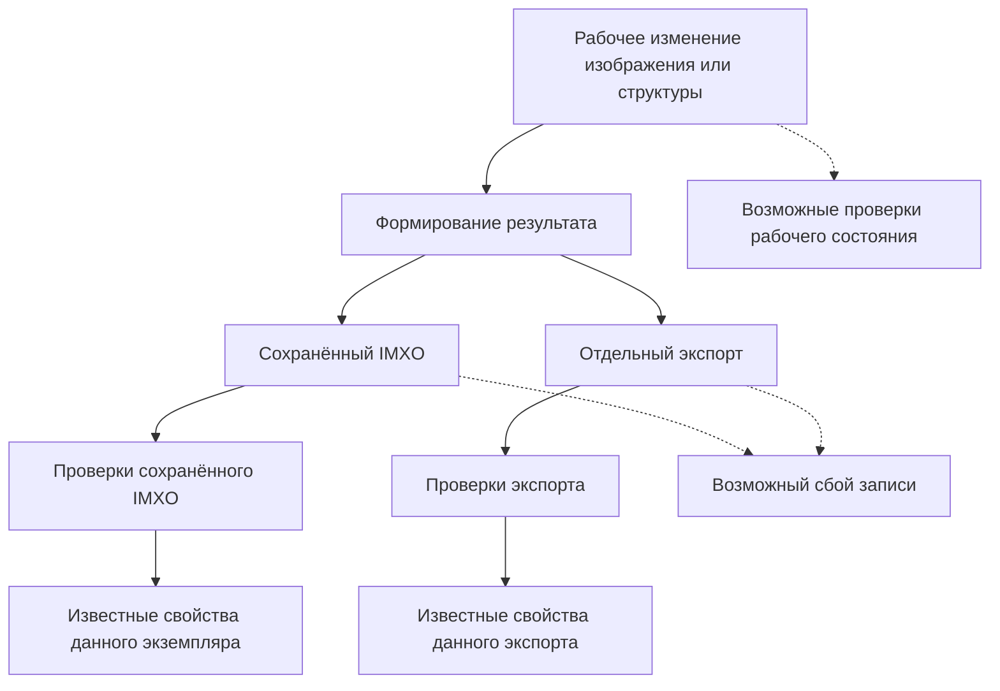

*Рис. 4.10 — Рабочее изменение, разные результаты и отдельные области проверки. Не задаёт обязательный конвейер, атомарность или журналирование.*

### 35.1. Сбой записи и устойчивость

При прерывании записи некоторые блоки могут оказаться отсутствующими или повреждёнными. Успешное завершение операции записи также не всегда гарантирует устойчивое сохранение при дальнейшем системном сбое. Конкретные механизмы атомарной замены, синхронизации, восстановления и журналирования здесь не определяются.

### 35.2. Повторное открытие

Программа может успешно читать собственный ошибочный экспорт, если писатель и читатель имеют одинаковое неправильное предположение. Независимая реализация способна обнаружить другой результат, но её независимость сама по себе не доказывает правоту. Важны проверяемые правила и данные.

### 35.3. Конкурирующие изменения

Два редактора могут менять не одни и те же байты, а разные взаимосвязанные области или аннотации. Их результаты способны стать противоречивыми. Выбор обязательных блокировок, транзакций и правил слияния находится вне этого USE.

## 36. Проверка результата и её границы

Определения целостности, происхождения, доверия и применимости даны в §28. Здесь рассматривается **что именно проверяется**, на каких данных и в каких пределах: физическая структура, синтаксис, известные ссылки, геометрическое преобразование, отдельная семантическая гипотеза, перенос ограничения или сохранённый экземпляр.

| Проверка | Что может подтверждаться | Чего она не доказывает |
|---|---|---|
| Чтение файла | Известное содержимое разобрано | Истинность всех аннотаций |
| Структурные ссылки | Известные ссылки разрешаются | Их правильную смысловую цель |
| Геометрия | Известное преобразование координат выполнено | Исходную правильность аннотации |
| Семантическая оценка | Отдельное утверждение проверено в данном контексте | Истинность прочих утверждений |
| Целостность блока | Неизменность определённых байтов | Применимость других связанных записей |
| Передача ограничений | Известное ограничение сохранено | Отсутствие неизвестных ограничений |

Различаются выполненная проверка без обнаруженного нарушения, обнаруженное нарушение, не проводившаяся проверка и безрезультатная попытка проверки. Это не нормативные перечисления состояний файла.

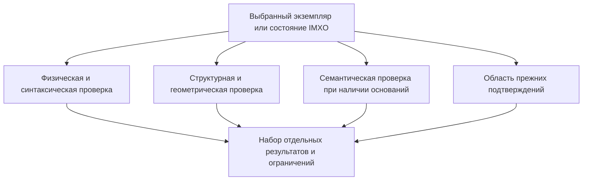

*Рис. 4.11 — Независимые проверки конкретного состояния. Итог не является универсальным числовым показателем доверия.*

### 36.1. Прежние подтверждения

Сохранённая отметка `verified`, результат человеческой проверки, хэш или цифровая подпись относятся к некоторому состоянию и области данных. После изменения эта связь может потерять применимость, но проверка независимого неизменённого блока не обязательно становится недействительной. Подпись не является автоматическим доказательством истинности изображённого содержания.

### 36.2. Область действия

Внешний анализ может установить дополнительные сведения, не записанные в файл. Последующая модификация файла может сделать прежнюю проверку неприменимой. Повторный анализ всего растра или применение ИИ не являются обязательной предпосылкой для проверки известных структур.

## 37. Недоверенные файлы и злоупотребления

IMXO v0.1 пассивный и не включает предусмотренные форматом исполняемые сценарии. Это не гарантирует отсутствия уязвимостей парсеров и редакторов. Недоверенный файл может содержать специально подобранные размеры, структуру, вложенность, идентификаторы, маски и отношения, вызывающие чрезмерный расход ресурсов или ошибки обработки.

### 37.1. Частичный разбор

Если неизвестное содержимое не удалось безопасно разобрать, доступность части данных не доказывает безопасности всего состояния. Ограниченная поддержка корректного расширения отличается от попытки продолжать работу после повреждения границ или непроверенных ссылок. Выбор конкретного поведения библиотеки остаётся открытым.

### 37.2. Ложные сведения и проверки

Злоумышленник может подменить аннотации, OCR, сведения об источнике или отметку проверки без изменения пикселей. Технически корректный файл не является автоматически достоверным. Также возможно случайное сохранение прежней истинной отметки, область действия которой уже изменилась.

### 37.3. Инструкции в данных

Структурированный текст может содержать просьбу выполнить сетевой запрос или игнорировать правила ИИ-системы. Такие строки остаются данными, а не командами IMXO. Полномочия внешнего потребителя и его политика действий лежат вне формата; граница подробно рассматривается в `USE-0003`.

## 38. Ресурсы, отображение и совместимость

Стоимость редактирования зависит не только от числа изменённых пикселей: маленькая область может иметь множество аннотаций и связанных утверждений. Циклические ссылки не обязательно образуют циклические зависимости. Частичное завершение из-за ограничений времени или памяти не доказывает, что все остальные данные неверны, но сужает подтверждаемую полноту.

### 38.1. Разные результаты отображения

Одинаковые сохранённые данные могут отображаться по-разному при отсутствии шрифта, иной растеризации вектора, несовпадающей цветопередаче, прозрачности, масках, смешивании и разных возможностях декодера. Геометрическая привязка текста может перестать соответствовать другому результату отображения. Здесь не принимаются правила обязательного встраивания шрифтов либо единого эталонного рендеринга.

### 38.2. Совместимость

Нужно различать возможность открыть файл, сохранность неизвестного блока, правильность структурных ссылок, смысловую применимость аннотаций и пригодность результата к задаче. Более старая реализация может читать изображение, но не понимать новые семантические расширения. При длительном хранении могут стать недоступными первоначальные шрифты, источники и программы; это не тождественно повреждению самого файла.

## 39. Приватность и невизуальная семантика

Структурированное содержимое не обязано полностью совпадать с видимыми пикселями. Альтернативные описания, доступные имена, OCR и семантические пояснения могут быть полезными законными сведениями. Невидимость сама по себе не является утечкой. Однако техническая доступность намеренно скрытого пароля приложения не разрешает его включать в обычный снимок.

После обычного редактирования в файле могут остаться скрытые слои, устаревший OCR, исходные области, уменьшенные копии, предыдущие значения и данные о происхождении. Это не обязательно ошибка обычного редактирования, но может быть существенным риском при последующем распространении. Даже видимые чувствительные данные после добавления OCR легче массово извлекать и индексировать.

Три границы сохраняются: **допустимый первоначальный захват** (`USE-0001`), **остаточные сведения после обычного изменения** (`USE-0004`) и **намеренное исключение выбранных данных из конечного файла** (`USE-0002`). Полная история не должна автоматически сохраняться исключительно ради полноты происхождения.

## 40. Проверочные случаи результата, отказов и безопасности

В отличие от §30, здесь собраны технические случаи сохранения, проверки, обмена и злоупотреблений. Это информативные примеры, не нормативный test suite.

| № | Случай | Исследуемое свойство |
|---|---|---|
| 1 | Изменён только OCR, изображение неизменно | Структурное редактирование |
| 2 | Рабочее изменение сделано, запись не началась | Рабочее и сохранённое состояние |
| 3 | Запись прервана | Неопределённость конечного файла |
| 4 | Файл читается, но известная ссылка нарушена | Читаемость и структурная согласованность |
| 5 | Проверено рабочее состояние, но не записанное | Область проверки |
| 6 | Проверенный экземпляр изменён до передачи | Проверенное и полученное состояние |
| 7 | Успешное повторное открытие собственным редактором | Предел самопроверки |
| 8 | Другая программа иначе интерпретирует файл | Совместимость |
| 9 | Шрифт заменён, расположение текста изменилось | Зависимость отображения |
| 10 | Непрозрачный блок скопирован без изменения | Байтовая и смысловая сохранность |
| 11 | Неподдерживаемый блок исключён | Последствия потери данных |
| 12 | Экспорт сохранил категорию, но потерял ограничение | Передача контекста |
| 13 | Пользователь требовал все аннотации, часть исключена | Существенные условия операции |
| 14 | Аннотация содержит инструкцию для ИИ | Данные и полномочия |
| 15 | Обработка прекращена лимитом ресурсов | Полнота и неопределённость |
| 16 | Парсер продолжил работу после повреждения границ | Безопасность частичного разбора |
| 17 | После перекрытия остались секретные значения | Редактирование и санитизация |
| 18 | Сохранено полезное невизуальное описание | Легитимная семантика |
| 19 | В файл попал невидимый пароль исходного приложения | Граница захвата |
| 20 | Два редактора изменили связанные структуры | Конкурентное редактирование |
| 21 | Осталась проверка прежнего состояния | Область действия подтверждения |
| 22 | Независимый блок проверяем после другого изменения | Локальная целостность |

**Составной пример:** пользователь исправляет OCR, переносит часть изображения, сохраняет IMXO и экспортирует растр. Сохранение IMXO прерывается; позже другая программа с иным окружением отображения читает частичный результат. Нужно выяснить, какой экземпляр реально записан, какие изменения относятся к структуре и пикселям, какие связи известны, какие ограничения переданы, что отображается и какие свойства проверены. Успешный показ картинки не разрешает всех вопросов.

Проверки могут быть структурными, опираться на подготовленные примеры или требовать внешних экспертных оснований. Не всякий семантический вывод доступен автоматической проверке без дополнительной информации. Связанные открытые вопросы: `Q-0002`, `Q-0003`, `Q-0007`, `Q-0008`, `Q-0009`, `Q-0011`, `Q-0012`, `Q-0014`.

## 41. Существующие способы решения задачи

Потребность объединять визуальное содержимое и структурированные сведения уже частично решается существующими стандартами. Поэтому недостаточно сравнивать IMXO с обычным PNG без расширений или с простым изображением без OCR. Сопоставлению подлежат реально осуществимые комбинации кодеков, контейнеров, моделей аннотаций, средств происхождения и редакторов.

### 41.1. Разные уровни технологии

| Уровень | Предмет сравнения | Примеры |
|---|---|---|
| Кодирование изображения | Представление пикселей и других визуальных данных | PNG, JPEG XL |
| Контейнер или документ | Совместное размещение и организация данных | TIFF, PDF, OpenRaster, JUMBF, ISO BMFF |
| Семантическая модель | Области, утверждения, отношения и привязка к состоянию | W3C Web Annotation, COCO, семейство YOLO |
| Происхождение и проверка | Источники, утверждения, область действия подтверждений | C2PA |

Границы не всегда строгие: SVG и PDF охватывают несколько уровней. Отдельная модель аннотаций не является прямым физическим конкурентом контейнера, поскольку может использоваться вместе с ним.

### 41.2. Стандарт, реализация и совместимость

Нужно различать возможность спецификации, действительную поддержку одной программы и доказанную совместимость нескольких независимых программ. Редактор может не сохранять расширение, разрешённое стандартом, либо поддерживать внутреннюю функцию, не передаваемую в обменном формате. Недостаток приложения не является автоматически недостатком формата.

### 41.3. PNG и `safe-to-copy`

PNG поддерживает дополнительные блоки. При работе с неизвестными типами существенны критичность блока, его вспомогательный статус, разрешение копирования и факт изменения критического содержимого. `safe-to-copy` задаёт правила обработки неизвестных вспомогательных блоков редакторами, но не проверяет смысловую применимость специализированной разметки.

Если блок содержит координаты автомобиля, технически разрешённое копирование после перемещения автомобиля не доказывает правильность этих координат. Если редактор исключает неизвестный блок согласно правилам формата, это не доказывает семантическую ненужность исключённого содержимого. Отдельно следует оценивать изменение только вспомогательной структуры без изменения изображения.

### 41.4. SVG 2 и Secure Static

SVG способен представлять вектор, растр, геометрию и текст. Наличие в полной модели SVG динамических возможностей нельзя использовать как единственный аргумент против него: SVG 2 описывает безопасные режимы обработки, включая **Secure Static**, ограничивающий сценарии, анимацию, интерактивность и внешние ссылки.

Необходимо проверить SVG как возможную статическую основу: выразительность аннотаций, обработку масок, смешанные изображения, последствия обычного редактирования, поддержку независимых редакторов и сохранение неизвестных расширений. Существование статического режима не означает, что он автоматически решает все исследуемые задачи IMXO.

### 41.5. OpenRaster и форматы редакторов

OpenRaster и собственные форматы редакторов, включая KRA и PSD, позволяют сохранять многослойность, группы и ряд редакторских свойств. Однако наличие слоёв не доказывает поддержку независимых структурированных утверждений с известными ограничениями применимости. Нужно сравнивать стандартное обменное представление и практическое поведение приложений отдельно.

### 41.6. PDF

PDF способен объединять растр, вектор, текст, аннотации и дополнительную структуру. В некоторых задачах он может быть достаточен. Необходим сравнительный анализ сложности обработки, повторного редактирования, переносимости графической структуры и стоимости интеграции. Более широкий документный характер PDF сам по себе не является аргументом непригодности.

### 41.7. JUMBF и контейнерные варианты

`ISO/IEC 19566-5:2023` описывает JUMBF. Опубликованная поправка **ISO/IEC 19566-5:2023/Amd 1:2025** расширяет его, в частности, самостоятельными JUMBF-файлами и сжатием. Поэтому JUMBF нельзя исследовать только как метаданные внутри JPEG.

Нужно рассмотреть JUMBF внутри соответствующего контейнера, самостоятельный JUMBF, изображение с дополнительными JUMBF-структурами и возможное повторное использование отдельных принципов в экспериментальном IMXO. Возможность автономного контейнера не доказывает существование готовой логической модели редактируемого изображения и необходимых независимых реализаций.

Другими возможными основами являются TIFF, ISO BMFF/HEIF, JPEG XL и другие контейнерные механизмы. Физическая возможность размещения данных не равна определённой семантике их сохранения после редактирования.

### 41.8. Web Annotation и CV-схемы

W3C Web Annotation Data Model уже предоставляет понятия ресурса, селекторов (`Selector`) и состояния (`State`), в том числе `TimeState`. Поэтому идею привязки аннотации к определённому состоянию нельзя считать принципиально новой. Однако `State` не обеспечивает сам по себе хранение прежней версии изображения или автоматический пересчёт области после преобразования.

Следует исследовать, как существующая модель переносит известную неопределённость, разные источники, геометрию после изменения и связь с локальным статическим содержимым. COCO, YOLO и другие CV-схемы являются дополнительными ориентирами по представлению разметки, но не всегда претендуют на роль контейнера для полного редактируемого изображения.

### 41.9. C2PA

C2PA предоставляет подход к происхождению медиаданных, проверяемым утверждениям, связям и областям действия подтверждений. Это ценный ориентир для `Q-0007` и `Q-0008`. Но криптографическая проверка происхождения не доказывает правильность классификации предметов на изображении.

### 41.10. Комбинированная альтернатива

Серьёзной альтернативой новому IMXO-контейнеру является существующий графический формат плюс общая модель аннотаций, привязка к состояниям и совместимый механизм происхождения. Она может оказаться дешевле в разработке или лучше поддерживаться. Наличие нескольких файлов создаёт возможные риски доставки и рассинхронизации, но не делает согласованность принципиально недостижимой.

**Вывод:** вопрос не в том, умеет ли существующий формат содержать произвольные метаданные, а в том, обеспечивается ли нужная модель и её сохранность при реальном редактировании независимыми программами.

## 42. Методика сравнения альтернатив

Сравнение должно раздельно оценивать физическое представление, логическую модель, редакторские операции, поддержку приложениями, отображение, безопасность, ресурсы и стоимость сопровождения. Успех одного удобного прототипа не является доказательством превосходства собственного контейнера.

### 42.1. Контроль факторов

| Вариант | Логическая модель | Хранение |
|---|---|---|
| A | Одна экспериментальная модель | Отдельный файл аннотаций |
| B | Та же модель | Расширение существующего контейнера |
| C | Та же модель | Экспериментальный контейнер IMXO |
| D | Подходящая существующая модель, например Web Annotation | Существующий способ хранения |
| E | Комбинация существующих моделей | Поддерживаемый контейнер или связанный набор файлов |

Сопоставимость вариантов не всегда полная; различия необходимо документировать. Для преимуществ новой логической модели полезно по возможности удерживать одинаковый контейнер, а для преимуществ контейнера — одинаковую модель.

### 42.2. Проверяемые операции

Набор должен включать структурное изменение без изменения пикселей, перемещение и копирование, частичное разделение, объединение, обрезку, перекрытие, правку текста, экспорт, обработку неизвестного расширения и обмен с другим редактором. Если формат не предназначен для операции, это следует фиксировать как границу области применения, а не автоматически считать дефектом.

### 42.3. Измеримые характеристики

Полезны размер и время записи, использование памяти, число потерянных аннотаций, правильность ссылок, число неправильно интерпретированных ограничений, воспроизводимость отображения и трудозатраты на исправление/разработку адаптера. Не следует смешивать физическую совместную доставку данных, структурную согласованность и смысловую применимость.

### 42.4. Эксплуатационные условия

Интерактивная и пакетная нагрузка, число аннотаторов и фрагментов, срок хранения, доступность исходного окружения и допустимость ручной проверки должны задаваться для конкретного эксперимента. Глобальная популярность формата не является метрикой конкретной операции. Нормативные пороги производительности пока не установлены.

## 43. Допущения и проверяемые гипотезы

Каждая гипотеза должна иметь варианты сравнения, операции, наблюдаемые показатели и потенциальный отрицательный результат. Пороговые значения нельзя назначать произвольно до базовых измерений.

### 43.1. Совместное хранение

**Гипотеза:** совместное размещение графики и аннотаций снижает потери при передаче относительно отдельного файла разметки. **Проверка:** перенос, сохранение, обновление версий. **Показатели:** отсутствующие связанные данные, ошибки версий, нарушения известных ссылок, стоимость восстановления. **Опровержение:** согласованные отдельные файлы демонстрируют сопоставимую или лучшую надёжность и удобство. Один контейнер не гарантирует смысловой согласованности.

### 43.2. Переносимость общей логической модели

**Гипотеза:** общая открытая модель уменьшает потери смысла между редакторами. **Проверка:** импорт, изменение, повторная запись независимой реализацией. **Показатели:** сохранённые утверждения, корректные связи, неправильные смысловые цели ссылок, потеря ограничений и ручные исправления. **Опровержение:** существующая модель достигает сравнимой переносимости без существенного расширения.

### 43.3. Совместное редактирование

**Гипотеза:** использование известных отношений снижает число рассогласований после типовых преобразований. **Проверка:** перемещение, копирование, разделение, обрезка. **Показатели:** устаревшие области, необоснованно унаследованные категории, избыточные удаления, ресурсы и стоимость реализации. **Опровержение:** новая модель создаёт не меньше ошибок или чрезмерно сложна.

### 43.4. Передача ограничений

**Гипотеза:** сохранение известных ограничений применимости снижает риск принятия старой записи за актуальную. **Проверка:** экспорт и последовательная передача между реализациями. **Показатели:** потерянные ограничения, неверно принятые утверждения и стоимость их обработки. **Опровержение:** ограничения практически не сохраняются или не улучшают интерпретацию получателями.

### 43.5. Несколько источников

**Гипотеза:** различение происхождения отдельных и производных записей помогает не принимать копии за независимые подтверждения. **Проверка:** импорт нескольких классификаций, копирование, объединение аннотаций. **Показатели:** корректность происхождения и количество ложных выводов о независимости. **Опровержение:** дополнительная модель не приносит измеримой пользы для выбранных задач.

### 43.6. Текст и отображение

**Гипотеза:** совместное представление символьного текста и графики облегчает исправление и повторное использование. **Проверка:** OCR, замена шрифта, изменение переносов, экспорт. **Показатели:** сохранность символов, геометрическое соответствие, трудоёмкость исправления, потери после отображения другим редактором. **Опровержение:** SVG, PDF или отдельный текстовый слой решают задачу дешевле.

### 43.7. Безопасное изменение

**Гипотеза:** различение обычного редактирования и санитизации уменьшает ошибочное раскрытие данных. **Проверка:** перекрытие, обрезка, удаление известных зависимых сведений, анализ остаточной структуры. **Показатели:** остаточные выбранные данные, ложные заявления об удалении, избыточная потеря независимой информации. **Опровержение:** предложенный подход не снижает риск по сравнению с существующим решением.

### 43.8. Необходимость нового контейнера

**Гипотеза:** собственный IMXO-контейнер обеспечивает измеримые преимущества при одинаковой логической модели. **Проверка:** одна модель в отдельном файле, расширяемом существующем контейнере и экспериментальном IMXO. **Показатели:** размер, время, ресурсы, поддержка неизвестных данных, корректность ссылок, совместимость, стоимость внедрения. **Опровержение:** существующий контейнер даёт сопоставимые или лучшие свойства при меньших затратах.

### 43.9. Интерпретация результатов

Преимущество по одной метрике не доказывает общего превосходства. Если исследование не подтверждает гипотезу, её нельзя спасать произвольным изменением критериев. Возможны разные результаты для разных эксплуатационных профилей. Отрицательный результат может обосновать существующий формат, ограниченное расширение, отдельную модель данных либо отказ от части функций.

## 44. Потенциальное значение сценария для IMXO

Возможная ценность общей модели заключается в представлении визуального содержимого, областей, текста, альтернативных утверждений, происхождения, отношений и доступных ограничений. Возможная ценность собственного контейнера — в упаковке, эффективности доступа, переносимости и поддержке изменений. Эти группы преимуществ необходимо исследовать отдельно.

### 44.1. Минимальный исследовательский пример

Начальный прототип может использовать простое изображение, несколько областей, наборы текстовых и смысловых утверждений, известные отношения, ограниченные операции, сохранение и независимое повторное чтение. Экспериментальные прямоугольные рамки, ID или структура файла остаются заменяемыми; они не становятся автоматически нормативной моделью IMXO.

### 44.2. Разные реализации

Просмотрщик, редактор OCR, графический редактор и специализированное CV-приложение могут иметь разную поддержку. Будущие требования к уровням соответствия и форматам проверки относятся к `Q-0011` и `Q-0012`; настоящий USE их не утверждает.

### 44.3. Пассивность и приватность

Обычное редактирование не требует исполняемых сценариев внутри файла и не обязывает сохранять всю историю или личные идентификаторы. Санитизация остаётся отдельным сценарием. Автоматическое разрешение внешних источников не является обязательным поведением файла.

### 44.4. Будущая возможность повторного использования в видео

Идентичность, происхождение и ограничения могут быть полезны в будущем видеоформате, однако успешность `USE-0004` не зависит от такого применения. В v0.1 не добавляются временные шкалы, синхронизация потоков или другая видео-специфичная модель.

## 45. Открытые вопросы и исследования

Связи ниже не заменяют `research-plan.md` и не означают утверждение требований. Новые RSCH-ID не создаются автоматически.

| Область | Вопросы | Исследования |
|---|---|---|
| Объекты, области, текст, отношения | Q-0003, Q-0009, Q-0010 | RSCH-0003, RSCH-0004, RSCH-0012 |
| Происхождение и целостность | Q-0007, Q-0008 | RSCH-0005, RSCH-0006 |
| Изменения файла, зависимости, санитизация как граница | Q-0002, Q-0014 | RSCH-0002, RSCH-0004, RSCH-0007 |
| Контейнерная архитектура | Q-0002, Q-0011 | RSCH-0001 |
| Частичная поддержка и проверяемость | Q-0011, Q-0012 | RSCH-0009 |

Исследования должны учитывать опубликованную поправку JUMBF 2025 года, SVG Secure Static, существующие селекторы и состояния Web Annotation, а также границы подтверждений C2PA. Самостоятельный JUMBF должен рассматриваться наряду с JUMBF внутри других форматов.

### 45.1. Нелинейная схема исследовательской работы

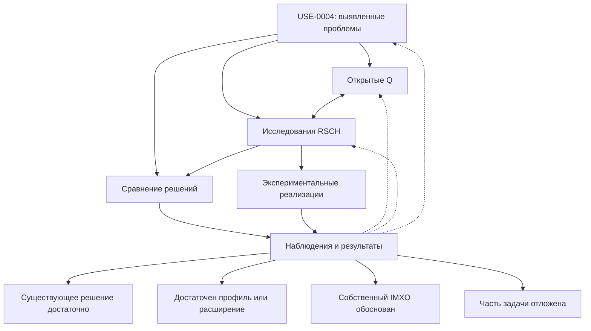

*Рис. 4.12 — Взаимосвязанные вопросы, исследования и возможные исходы. Это не обязательная линейная последовательность процесса.*

Ни один из исходов не является заранее предпочтительным или обязательным. Сравнение может показать, что существующего контейнера достаточно, а новая логическая модель всё же полезна. Управление сроками и очередью исследований остаётся в проектном плане.

## 46. Связанные артефакты и внешние основания

### 46.1. Связанные сценарии

- [`USE-0001`](USE-0001-structured-screenshot-content.md) — допустимое получение и сохранение структурированного содержимого пользовательского снимка;
- [`USE-0002`](USE-0002-safe-sanitization.md) — намеренная санитизация, отличающаяся от обычного редактирования;
- [`USE-0003`](USE-0003-structured-screenshot-ai-input.md) — интерпретация структурированного снимка ИИ-потребителем.

### 46.2. Открытые вопросы

- [`Q-0002`](../project/questions/Q-0002-physical-file-structure.md) — физическая модель;
- [`Q-0003`](../project/questions/Q-0003-logical-object-model.md) — объекты и отношения;
- [`Q-0007`](../project/questions/Q-0007-provenance-model.md) — происхождение;
- [`Q-0008`](../project/questions/Q-0008-integrity-trust-model.md) — целостность и доверие;
- [`Q-0009`](../project/questions/Q-0009-cv-annotations.md) — CV-аннотации;
- [`Q-0010`](../project/questions/Q-0010-accessibility-model.md) — доступность;
- [`Q-0011`](../project/questions/Q-0011-sdk-integrations.md) — SDK;
- [`Q-0012`](../project/questions/Q-0012-conformance-model.md) — соответствие;
- [`Q-0014`](../project/questions/Q-0014-safe-editing-cascade-operations.md) — безопасное изменение и зависимости.

### 46.3. Связанные исследования

- [`RSCH-0001`](../research/RSCH-0001-container-architecture-comparison.md) — контейнеры;
- [`RSCH-0002`](../research/RSCH-0002-safe-physical-file-updates.md) — безопасная запись;
- [`RSCH-0003`](../research/RSCH-0003-text-layer-models.md) — текстовый слой;
- [`RSCH-0004`](../research/RSCH-0004-object-relationships-alternative-assertions.md) — отношения;
- [`RSCH-0005`](../research/RSCH-0005-provenance-transformation-chains.md) — происхождение;
- [`RSCH-0006`](../research/RSCH-0006-integrity-consistency-trust-boundaries.md) — целостность;
- [`RSCH-0007`](../research/RSCH-0007-structured-file-sanitization.md) — санитизация как граница сценария;
- [`RSCH-0009`](../research/RSCH-0009-partial-representations-selective-extraction.md) — неполные представления;
- [`RSCH-0012`](../research/RSCH-0012-cv-annotation-interchange-formats.md) — обмен CV-разметкой.

Карточки исследований на момент подготовки данного USE находятся в разработке (`DRAFT`); ссылки не означают полученных исследовательских выводов. Отсутствуют утверждённые `REQ`, `DES`, `ADR` и `SPEC`, непосредственно выводимые из этого USE.

### 46.4. Внешние стандарты и спецификации

- [PNG Specification, Third Edition — W3C Recommendation](https://www.w3.org/TR/png-3/) — структура блоков и `safe-to-copy`.
- [SVG 2 — W3C Candidate Recommendation Snapshot](https://www.w3.org/TR/SVG2/) — смешанная графика и режимы, включая Secure Static.
- [Web Annotation Data Model — W3C Recommendation](https://www.w3.org/TR/annotation-model/) — аннотации, селекторы и состояние ресурса.
- [Web Annotation Selectors and States — W3C Working Group Note](https://www.w3.org/TR/selectors-states/) — дополнительный материал по селекторам и состояниям; не приписывать статус Recommendation.
- [OpenRaster](https://www.openraster.org/) — обменный многослойный формат; различать стандарт и возможности редакторов.
- [ISO/IEC 19566-5:2023 — JUMBF](https://www.iso.org/standard/84635.html) — основной стандарт JUMBF.
- [ISO/IEC 19566-5:2023/Amd 1:2025 — JUMBF Box Compression and Standalone JUMBF Files](https://webstore.iec.ch/en/publication/106543) — опубликованная поправка.
- [JPEG XL — JPEG Committee](https://jpeg.org/jpegxl/) — кодирование и контейнерные представления.
- [C2PA Technical Specification](https://spec.c2pa.org/) — происхождение и проверяемые утверждения.

Перечень служит постановке вопросов и не является завершённым исследовательским обзором. Статус и редакции внешних стандартов при публикации следует перепроверить. Возможности спецификации, приложения и межпрограммной совместимости не смешивать.

### 46.5. Связь с исследовательским планом

Наблюдения этого USE являются источником вопросов и проверочных примеров для существующего [`research-plan.md`](../project/research-plan.md). Не следует создавать новый параллельный план, назначать сроки или объявлять работу выполненной по одному факту наличия ссылок.

## 47. Итог, не принятые предположения и основания пересмотра

### 47.1. Центральное наблюдение

Редактирование структурированного изображения изменяет не только пиксели. Текст, области, отношения, происхождение, классификации и условия отображения способны меняться самостоятельно и не обязаны сохранять одинаковую применимость. Сохранение записи не доказывает её актуальности, а технически правильное преобразование не доказывает семантической истинности.

### 47.2. Не принятые универсальные предположения

Не принимаются как универсально верные утверждения: один файл гарантирует согласованность; существующие форматы не умеют хранить дополнительные данные; новый контейнер всегда лучше; общая семантическая модель требует новой упаковки; геометрическое пересечение доказывает зависимость; общее происхождение доказывает независимое подтверждение; совпадающий хэш подтверждает истинность; неизвестный блок всегда следует удалить либо всегда сохранить; всем редакторам требуется повторно выполнять OCR/CV; полная история обязательна; успешное открытие доказывает одинаковое отображение.

Не принимаются как универсальные стратегии безусловное наследование всех аннотаций, массовое удаление неизвестной структуры, объявление любой неизвестности ошибкой, приравнивание обычной обрезки к санитизации, единый числовой `trust score` и встроенное исполняемое поведение.

### 47.3. Возможные исходы исследования

Результатом может оказаться: (1) собственный IMXO технически оправдан; (2) достаточно существующего контейнера с общей моделью; (3) достаточно профиля или расширения существующего стандарта; (4) предпочтительно отдельное представление аннотаций; (5) часть функциональности следует отложить. Исходы могут сочетаться для разных задач.

**Результат «новый контейнер не нужен» является полноценным исследовательским выводом.** Сценарий сам по себе не доказывает необходимость собственной бинарной конструкции, универсального графа объектов, обязательной истории или экономическую выгоду создания нового формата.

### 47.4. Основания для пересмотра

Новые типы операций, подтверждённые ошибки, результаты независимых прототипов, изменения внешних стандартов, количественные данные и новые границы безопасности могут стать основаниями для корректировки сценария. Существенные изменения проходят процесс PREP-08; историю нельзя переписывать задним числом.

### 47.5. Итоговый вывод

**Главный результат USE-0004 — проверяемая постановка задачи согласованного редактирования структурированного изображения, а не утверждение о готовом техническом решении.** Нужные свойства следует исследовать на уровне логической модели, упаковки и реального поведения приложений отдельно.

## Supersession

**Supersedes:** none  
**Superseded by:** none

## History

- 2026-10-28 — карточка опубликована в русском дереве документации как `DRAFT / CANDIDATE`; отдельный дословный ранний исходник §§1–20 в рабочем дереве и истории репозитория не найден, подключён авторский SVG для рис. 4.4 и проверены локальные связи.
- 2026-10-27 — подготовлена интегрированная рабочая редакция §§1–47 после последовательных критических проходов. Первые два блока реконструированы по известной согласованной структуре и должны быть сверены с оригиналами перед окончательной публикацией. Документ остаётся `DRAFT / CANDIDATE` до авторского review и проверки иллюстраций/ссылок.
